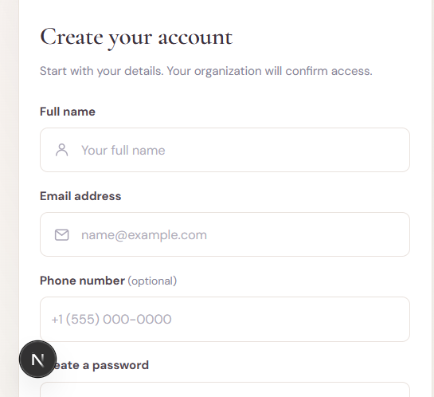
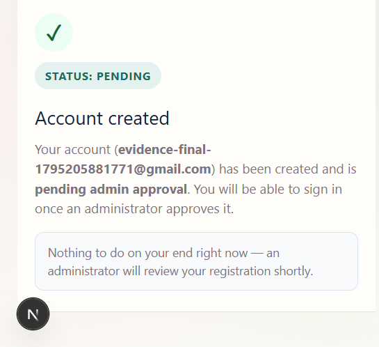
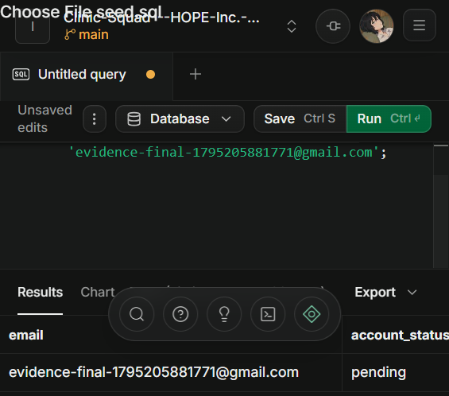

# S1-DEV-02 verification — registration API (new users start pending)

- Issue: [#18 — S1-DEV-02: Register user form and API (new users start as pending)](https://github.com/jamesseno/Clinic-Squad---HOPE-Inc.-Midterm-Project/issues/18)
- Branch: `feat/user-registration-pending`
- Supabase project: `aiqtirybcgwfgsrppidz` (`https://aiqtirybcgwfgsrppidz.supabase.co`)
- Date verified: 2026-11-21

## What was implemented

- `POST /api/auth/register` validates the payload, rejects duplicates with `409`,
  creates the Supabase Auth user (password hashing stays in Supabase Auth), and
  inserts a matching row into `public.app_user`.
- The service-role insert hardcodes `account_status: "pending"` and resolves the
  `role_id` for `role_code = "user"` on the server. Caller-supplied
  `account_status`, `role_id`, `is_blocked`, and `id` are rejected with `400`.
- `lib/registration.ts` contains dependency-free strict validation shared by the
  API and the optional `RegisterForm` component.
- No existing UI file was changed. The optional standalone form is exposed at
  `/register-evidence` only for verification; the existing landing-page form is
  untouched.

## Database setup used for verification

Applied in the hosted project's SQL Editor:

1. `supabase/migrations/20261119084800_app_user_roles_modules_and_permissions.sql`
2. `supabase/migrations/20261121005600_role_permission_mapping.sql`
3. `supabase/seed.sql`

The later role-permission migration is required before `seed.sql`, because the
seed prunes stale `public.role_permission` rows.

## Automated verification

Command: `npm run verify:registration`

```text
> hope-inc-erp@0.1.0 verify:registration
> node --env-file=.env.local scripts/verify-registration.mjs

✓ server-controlled fields are rejected (HTTP 400)
✓ registration succeeded (HTTP 201)
✓ API response reports account_status=pending
✓ API returned a user id
✓ duplicate email rejected (HTTP 409)
✓ profile row exists in public.app_user
✓ profile.account_status === 'pending'
✓ profile was assigned the standard user role
✓ status remains pending after unauthorized update attempt

All S1-DEV-02 registration checks passed.
Cleaned up verification user.
```

Static checks:

```text
> npm run typecheck
> tsc --noEmit
# no errors

> npm run lint
> eslint .
app\layout.tsx
  20:9  warning  Custom fonts not added in `pages/_document.js` will only load for a single page. ...  @next/next/no-page-custom-font
✖ 1 problem (0 errors, 1 warning)
```

The lint warning is pre-existing and unrelated to this change.

## UI evidence

Registration form (standalone evidence route; existing landing-page UI unchanged):



Successful submission:

> ✓ STATUS: PENDING  
> Account created  
> Your account (evidence-final-1795205881771@gmail.com) has been created and is
> pending admin approval. You will be able to sign in once an administrator
> approves it.  
> Nothing to do on your end right now — an administrator will review your
> registration shortly.



## Database evidence

SQL run in Supabase SQL Editor:

```sql
select email, account_status, created_at
from public.app_user
where email = 'evidence-final-1795205881771@gmail.com';
```

Result:

| email | account_status | created_at |
| --- | --- | --- |
| evidence-final-1795205881771@gmail.com | pending | 2026-11-20 20:18:05.04416+00 |

Service-role read-back:

```json
{
  "email": "evidence-final-1795205881771@gmail.com",
  "first_name": "Evidence",
  "last_name": "User",
  "account_status": "pending",
  "is_blocked": false,
  "created_at": "2026-11-20T20:18:05.04416+00:00"
}
```


