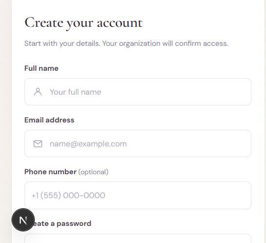
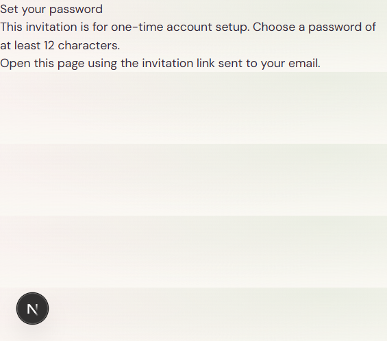

# S1-DEV-03 verification — login/logout, sessions, and first-password setup

- Issue: [#19 — S1-DEV-03: Login and logout with session handling, set-password](https://github.com/jamesseno/Clinic-Squad---HOPE-Inc.-Midterm-Project/issues/19)
- Branch: `feat/s1-dev-03-auth-session`
- Supabase project: `aiqtirybcgwfgsrppidz` (`https://aiqtirybcgwfgsrppidz.supabase.co`)
- Date verified: 2026-11-21

## What was implemented

- `POST /api/auth/login` validates `{ email, password, remember? }`, rejects
  server-owned fields, checks that the matching `public.app_user` row is active
  and not blocked, then creates a Supabase Auth session in HTTP-only cookies.
- `GET /api/auth/session` validates the Auth session and re-checks the profile.
  `proxy.ts` applies the same active/unblocked rule to every request and clears
  the session when an account is blocked.
- `POST /api/auth/logout` destroys the session and clears its cookies.
- `POST /api/auth/set-password` requires an active session, validates a
  first-login password (12+ characters with upper/lower case and a number),
  updates it through Supabase Auth so it is hashed server-side, and clears the
  one-time `password_setup_required` flag.
- `scripts/invite-superadmins.mjs` now marks invited accounts with
  `password_setup_required: true`; `POST /api/auth/register` marks normal
  registrations with `false`.
- Added `20261121030000_grant_app_private_to_service_role.sql` so server-side
  profile updates (for example, blocking a user) can run the `app_private`
  update trigger with the service-role key.
- No existing UI file was changed. The existing login and set-password screens
  were used for visual evidence only.

## Database setup used for verification

Applied in the hosted project's SQL Editor:

1. `supabase/migrations/20261119084800_app_user_roles_modules_and_permissions.sql`
2. `supabase/migrations/20261121005600_role_permission_mapping.sql`
3. `supabase/migrations/20261121002205_password_reset_token.sql`
4. `supabase/migrations/20261121030000_grant_app_private_to_service_role.sql`
5. `supabase/seed.sql`

## Automated verification

Command: `npm run verify:auth`

```text
> hope-inc-erp@0.1.0 verify:auth
> node --env-file=.env.local scripts/verify-auth.mjs

✓ server-controlled login fields are rejected (HTTP 400)
✓ incorrect password is rejected (HTTP 401)
✓ active user signs in (HTTP 200)
✓ login reports account_status=active
✓ registered user does not need first-password setup
✓ session cookie authenticates a protected request
✓ session resolves the signed-in user
✓ logout destroys the session (HTTP 204)
✓ session is denied after logout (HTTP 401)
✓ user signs in before being blocked (HTTP 200)
✓ session works while the account is unblocked
✓ blocking a user invalidates the active session (redirect to login)
✓ blocked user cannot sign in (HTTP 403)
✓ pending user cannot sign in (HTTP 403)
✓ first-login user signs in (HTTP 200)
✓ login reports first-password setup required
✓ weak first password is rejected (HTTP 400)
✓ first-password setup succeeds (HTTP 200)
✓ setup clears the first-login flag
✓ session remains valid after password setup
✓ session reports setup complete
✓ temporary password no longer works (HTTP 401)
✓ new password works after setup (HTTP 200)
✓ new login does not require setup again

All S1-DEV-03 authentication checks passed.
Cleaned up verification users.
```

Static checks:

```text
> npm run typecheck
> tsc --noEmit
# no errors

> npm run lint
> eslint .
app\layout.tsx
  20:9  warning  Custom fonts not added in `pages/_document.js` will only load for a single page. ...  @next/next/no-page-custom-font
✖ 1 problem (0 errors, 1 warning)

> npm run build
> next build
✓ Compiled successfully
✓ Generating static pages (6/6)
```

The lint warning is pre-existing and unrelated to this change.

## UI evidence

Existing login screen (unchanged):



Existing one-time set-password screen (unchanged):



## Notes

- Password values never appear in source control, logs, or API responses.
- Supabase Auth owns password hashing; the app only calls
  `signInWithPassword`, `updateUser`, and `signOut`.
- All verification users were removed after the run (`auth-` users: 0).
