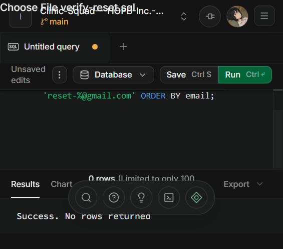
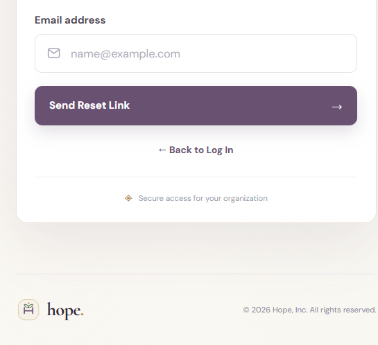
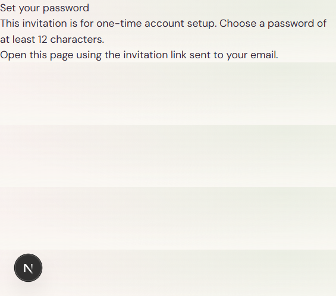

# S1-DEV-04 verification — password reset request, emailed token, and reset form

- Issue: [#20 — S1-DEV-04: Reset password: request, emailed token, reset form](https://github.com/jamesseno/Clinic-Squad---HOPE-Inc.-Midterm-Project/issues/20)
- Branch: `feat/s1-dev-04-reset-password`
- Supabase project: `aiqtirybcgwfgsrppidz` (`https://aiqtirybcgwfgsrppidz.supabase.co`)
- Date verified: 2026-11-21

## What was implemented

- `POST /api/auth/reset/request` accepts `{ email }`, rejects server-owned
  fields, and returns the same generic message whether or not the email exists.
  For an active, unblocked `public.app_user`, it generates a 32-byte token,
  stores only its SHA-256 hash in `public.password_reset_token` with a 30-minute
  expiry, revokes older unused tokens, and asks Supabase Auth to email a
  recovery link to the existing `/set-password` page with that token.
- `GET /api/auth/reset/verify?token=...` reports whether a token is valid,
  unused, and unexpired without consuming it.
- `POST /api/auth/reset/confirm` accepts `{ token, password, confirmPassword }`,
  validates the new password, atomically claims the one-time token, updates the
  password through Supabase Auth (so it is hashed server-side), and rejects
  reused, expired, malformed, unknown, pending, and blocked accounts.
- No existing UI file was changed. The existing reset-request form and
  set-password screen were used as-is for the emailed link and visual evidence.

## Database checks

Ran `supabase/verify-reset.sql` in the hosted Supabase SQL Editor:

```text
reset_token_table_exists | service_role_can_read | service_role_can_insert | service_role_can_update
true                     | true                  | true                    | true

unused_reset_tokens | expired_unused_tokens
0                   | 0

SELECT email, account_status, is_blocked
FROM public.app_user
WHERE email LIKE 'reset-%@gmail.com'
→ Success. No rows returned
```



## Automated verification

Command: `npm run verify:reset`

```text
> hope-inc-erp@0.1.0 verify:reset
> node --env-file=.env.local scripts/verify-reset-password.mjs

✓ server-controlled reset fields are rejected (HTTP 400)
✓ unknown email returns the same generic response (HTTP 200)
✓ reset request is accepted (HTTP 200)
✓ request stores a hashed, unused token with a future expiry
✓ valid token verifies (HTTP 200)
✓ weak reset password is rejected (HTTP 400)
✓ mismatched reset passwords are rejected (HTTP 400)
✓ valid token sets a new password (HTTP 200)
✓ reset token cannot be reused (HTTP 400)
✓ used token fails verification
✓ old password no longer signs in (HTTP 401)
✓ new password signs in (HTTP 200)
✓ expired token fails verification (HTTP 400)
✓ expired token cannot reset a password (HTTP 400)
✓ password is unchanged after an expired token attempt
✓ malformed token is rejected (HTTP 400)
✓ unknown token is rejected (HTTP 400)
✓ a newer request revokes the older unused token
✓ revoked token cannot reset a password (HTTP 400)
✓ blocked account receives no reset token
✓ blocked account cannot complete a reset (HTTP 403)
✓ pending account receives no reset token

All S1-DEV-04 password reset checks passed.
Cleaned up verification users.
```

Static checks:

```text
> npm run typecheck
> tsc --noEmit
# no errors

> npm run lint
> eslint .
app\layout.tsx
  20:9  warning  Custom fonts not added in `pages/_document.js` will only load for a single page. ...  @next/next/no-page-custom-font
✖ 1 problem (0 errors, 1 warning)

> npm run build
> next build
✓ Compiled successfully
✓ Generating static pages (6/6)
```

The lint warning is pre-existing and unrelated to this change. The build lists
`/api/auth/reset/request`, `/api/auth/reset/verify`, and
`/api/auth/reset/confirm` as dynamic routes.

## UI evidence

Existing reset-request form (unchanged):



Existing set-password screen that the emailed recovery link opens (unchanged):



## Notes

- The raw token is only present in the emailed link and is never stored in the
  database, logs, or API responses; only its SHA-256 hash is stored.
- Supabase Auth owns password hashing. The app calls `resetPasswordForEmail`
  for delivery and `admin.updateUserById` for the password change.
- All verification users were removed after the run (`reset-%@gmail.com` rows: 0).
