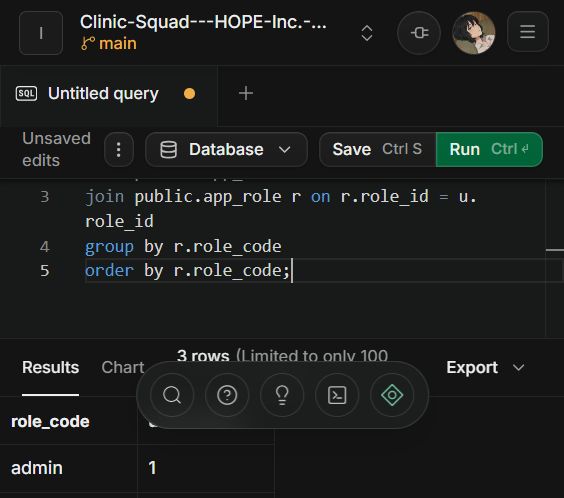
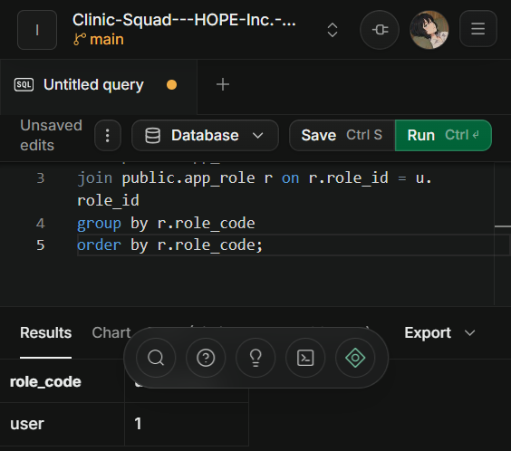
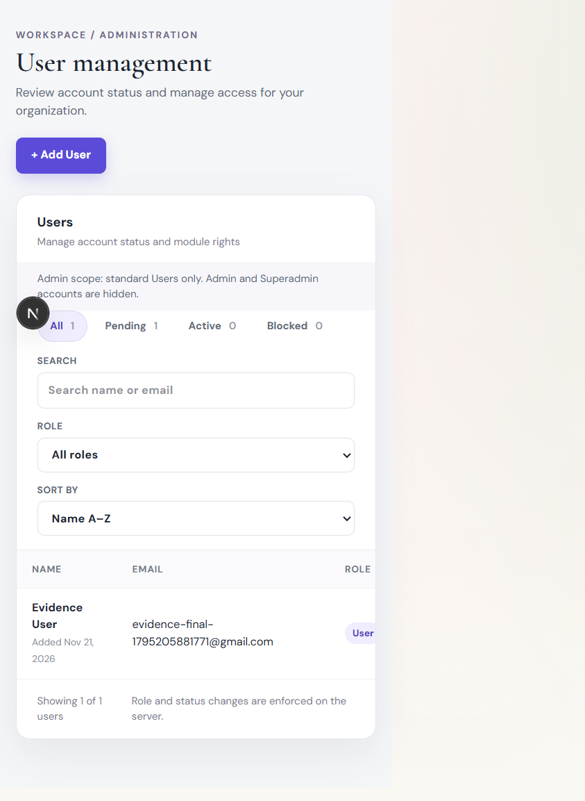
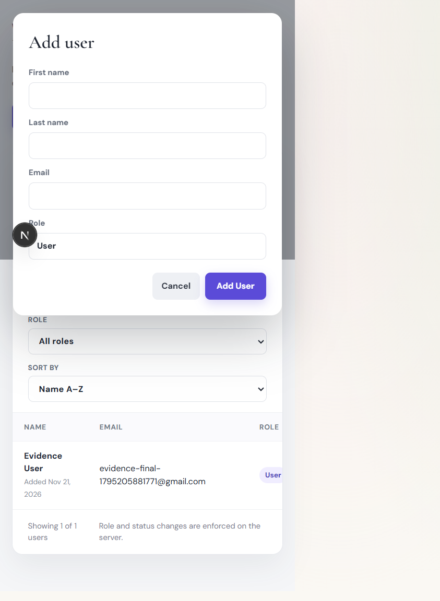
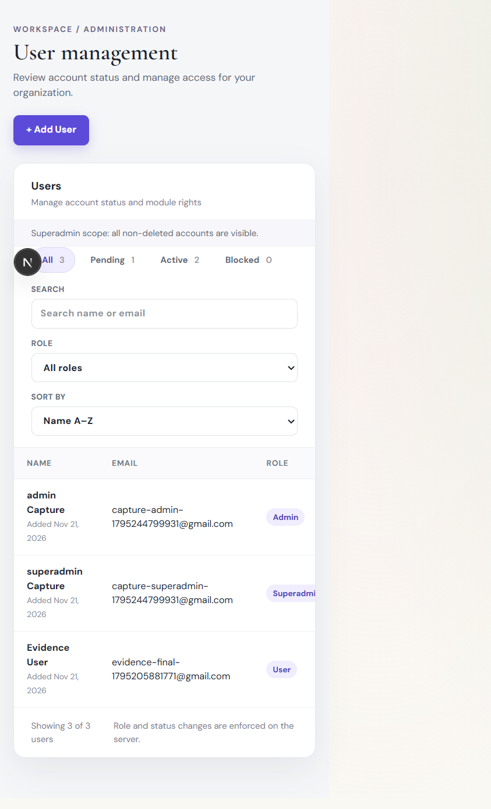

# S1-DEV-05 verification — user management (list, add, edit, block/unblock)

- Issue: [#22 — S1-DEV-05: User management](https://github.com/jamesseno/Clinic-Squad---HOPE-Inc.-Midterm-Project/issues/22)
- Branch: `feat/s1-dev-05-user-management`
- Supabase project: `aiqtirybcgwfgsrppidz` (`https://aiqtirybcgwfgsrppidz.supabase.co`)
- Date verified: 2026-11-21

## What was implemented

- New `/users` screen with status tabs, search, role filter, sort order, Add
  User, Edit User, and Block/Unblock controls. No existing UI file was changed.
- New server-only manager gate in `lib/user-management.ts`. It resolves the
  role from the authenticated, active, unblocked `public.app_user` row; it never
  trusts a role from the request body.
- New APIs:
  - `GET /api/users` — role-aware list. Admin is explicitly restricted to
    `role_code = 'user'`; Superadmin sees all roles. RLS remains authoritative.
  - `POST /api/users` — creates a Supabase Auth user and matching `app_user`
    profile. Admin may create only standard Users; Superadmin may create any
    role. The one-time temporary password is returned only in the response.
  - `PATCH /api/users/[id]` — updates name fields, plus role for Superadmin
    only. Rejects unknown/server-owned fields.
  - `POST /api/users/[id]/status` — block/unblock action with the last-active
    Superadmin guard.
- `lib/user-validation.ts` rejects unexpected keys such as `role_id`,
  `account_status`, and `is_blocked`, so the browser cannot escalate a role or
  change a status field directly.
- The last active, unblocked Superadmin cannot be blocked or demoted.
- Admin cannot read, edit, block, or unblock Admin/Superadmin accounts: hidden
  rows return HTTP 404 on direct API access.

## Database checks

Ran this query in the hosted Supabase SQL Editor with the temporary capture
accounts present:

```sql
select r.role_code, count(*) as user_count
from public.app_user u
join public.app_role r on r.role_id = u.role_id
group by r.role_code
order by r.role_code;
```

```text
role_code   user_count
admin       1
superadmin  1
user        1
```



After the capture accounts and all verification accounts were removed:

```text
role_code   user_count
user        1
```



## Automated verification

Command: `npm run verify:users`

```text
> hope-inc-erp@0.1.0 verify:users
> node --env-file=.env.local scripts/verify-user-management.mjs

✓ unauthenticated user list is denied (HTTP 401)
✓ standard user signs in (HTTP 200)
✓ standard user cannot open user management (HTTP 403)
✓ admin signs in (HTTP 200)
✓ admin can open user management (HTTP 200)
✓ admin role is reported by the server
✓ admin list contains only standard Users
✓ admin and superadmin accounts are hidden from admin
✓ admin can add a standard user (HTTP 201)
✓ add response returns a one-time temporary password
✓ added user is forced to the standard User role
✓ temporary password signs in (HTTP 200)
✓ added user must set a new password on first login
✓ admin cannot create an admin account (HTTP 400)
✓ server-owned block field is rejected (HTTP 400)
✓ superadmin signs in (HTTP 200)
✓ superadmin can open user management (HTTP 200)
✓ superadmin list includes all roles
✓ admin can edit a standard user (HTTP 200)
✓ first name change is persisted
✓ admin cannot promote a user (HTTP 400)
✓ admin cannot edit a hidden superadmin (HTTP 404)
✓ admin can block a standard user (HTTP 200)
✓ blocked user cannot sign in (HTTP 403)
✓ admin can unblock a standard user (HTTP 200)
✓ unblocked user can sign in again (HTTP 200)
✓ last active superadmin cannot be blocked (HTTP 409)
✓ last active superadmin cannot be demoted (HTTP 409)

All S1-DEV-05 user management checks passed.
Cleaned up verification users.
```

Static checks:

```text
> npm run typecheck
> tsc --noEmit
# no errors

> npm run lint
> eslint .
app\layout.tsx
  20:9  warning  Custom fonts not added in `pages/_document.js` will only load for a single page. ...  @next/next/no-page-custom-font
✖ 1 problem (0 errors, 1 warning)

> npm run build
> next build
✓ Compiled successfully
✓ Generating static pages (7/7)
```

The lint warning is pre-existing and unrelated to this change. The build lists
`/api/users`, `/api/users/[id]`, `/api/users/[id]/status`, and `/users` as
dynamic routes.

## UI evidence

Admin view — only standard Users are visible, and the scope note explains the
restriction:



Admin Add User modal — role is read-only as User for Admin sessions:



Superadmin view — all roles are visible and role selection is available:



## Notes

- Supabase Auth owns account creation, password hashing, and sign-in. The app
  uses the service-role client only for privileged profile writes and cleanup.
- Blocking sets `app_user.is_blocked`; the existing access check rejects sign-in
  for blocked accounts until they are unblocked.
- Temporary passwords are shown once in the Add User response and are never
  persisted by the application.
- All verification and capture users were deleted after the run. The final SQL
  check confirms only the original pending standard user remains.
