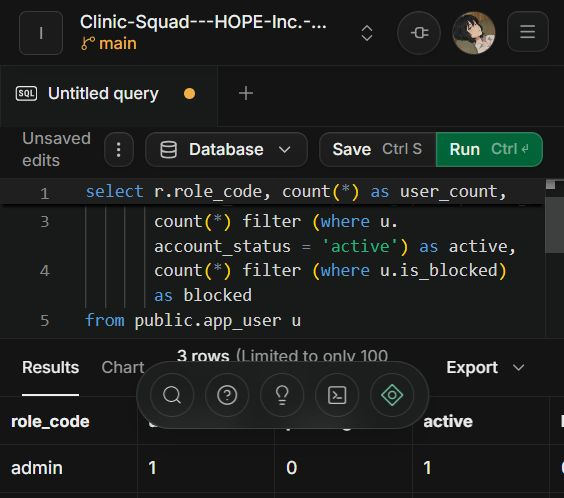
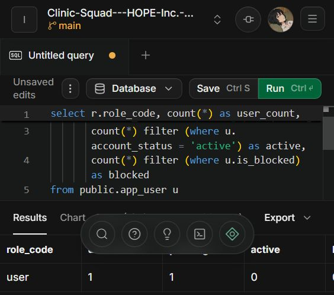
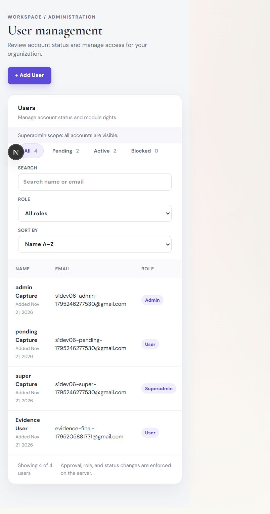
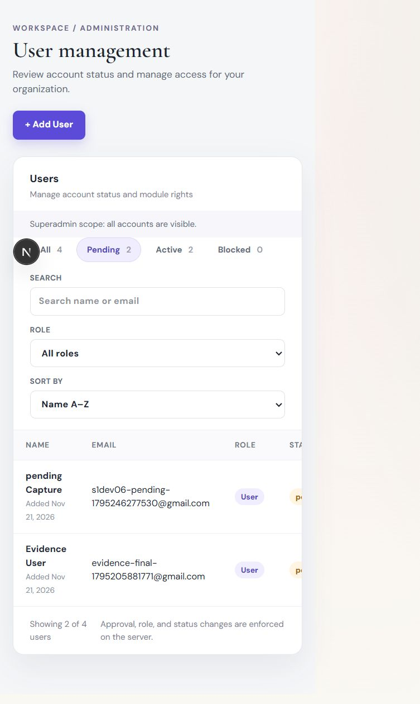
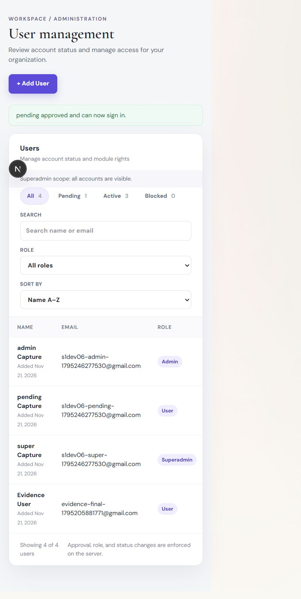
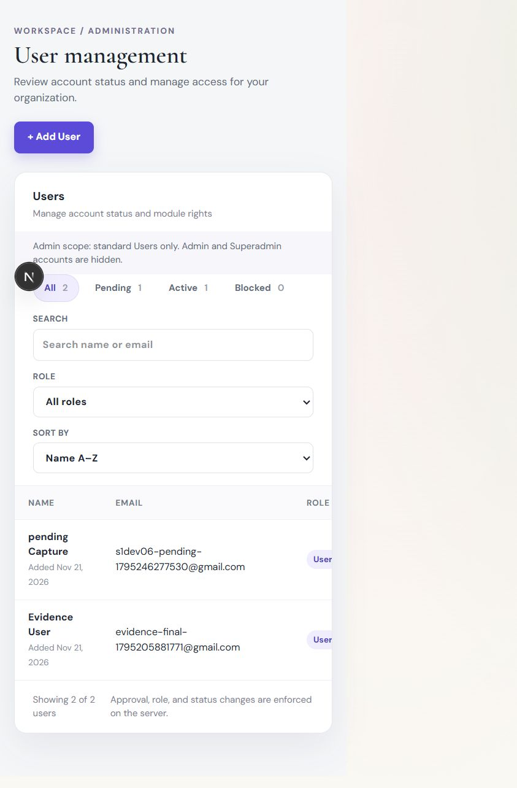
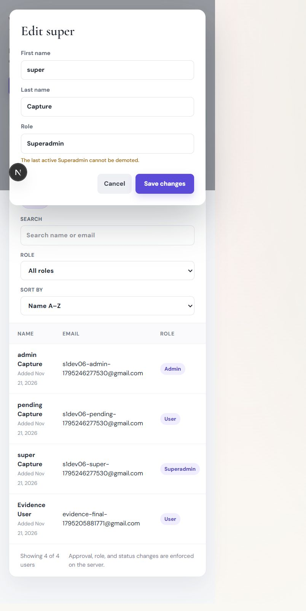

# S1-DEV-06 verification — approve pending users, designate admins, protect the last Superadmin

- Issue: [#23 — S1-DEV-06: Superadmin: approve pending users, designate admins](https://github.com/jamesseno/Clinic-Squad---HOPE-Inc.-Midterm-Project/issues/23)
- Branch: `feat/s1-dev-06-user-approval`
- Supabase project: `aiqtirybcgwfgsrppidz` (`https://aiqtirybcgwfgsrppidz.supabase.co`)
- Date verified: 2026-11-21

## What was implemented

- `POST /api/users/[id]/approve` is Superadmin-only. It approves a pending,
  unblocked account and may optionally designate it as an Admin (`{ "role": "admin" }`).
  Approval status and other server-owned fields cannot be supplied by the client.
- The `/users` screen now shows **Approve** and **Approve as Admin** actions on
  pending rows for Superadmin sessions only. Admin sessions have no approval
  controls.
- Superadmins can designate Admins from the Edit modal role selector. Admins
  cannot change roles; validation rejects such requests before any write.
- `GET /api/users` reports `protected: true` for the single active, unblocked
  Superadmin. The UI shows a **Protected** badge, removes the Block control, and
  makes the role read-only in that row's Edit modal.
- The last active Superadmin cannot be disabled by blocking, demoted to another
  role, or removed. `DELETE /api/users/[id]` is an explicit guardrail: it returns
  HTTP 409 for the last active Superadmin and HTTP 405 for everyone else because
  account deletion is intentionally unsupported (blocking preserves history).
- No existing UI files were changed outside the `/users` screen, and no SQL
  migration was needed — the existing RLS policies and guard trigger are reused.

## Database checks

Ran this query in the hosted Supabase SQL Editor with the capture accounts still
present:

```sql
select r.role_code, count(*) as user_count,
       count(*) filter (where u.account_status = 'pending') as pending,
       count(*) filter (where u.account_status = 'active') as active,
       count(*) filter (where u.is_blocked) as blocked
from public.app_user u
join public.app_role r on r.role_id = u.role_id
group by r.role_code
order by r.role_code;
```

```text
role_code    user_count  pending  active  blocked
admin        1           0        1       0
superadmin   1           0        1       0
user         2           1        1       0
```



After all capture and verification accounts were removed:

```text
role_code   user_count  pending  active  blocked
user        1           1        0       0
```



## Automated verification

Command: `npm run verify:approval`

```text
> hope-inc-erp@0.1.0 verify:approval
> node --env-file=.env.local scripts/verify-user-approval.mjs

✓ unauthenticated approval is denied (HTTP 401)
✓ standard user signs in (HTTP 200)
✓ standard user cannot approve (HTTP 403)
✓ admin signs in (HTTP 200)
✓ admin cannot approve (HTTP 403)
✓ failed approval attempts leave the account pending
✓ pending user cannot sign in (HTTP 403)
✓ pending sign-in reports the approval requirement
✓ superadmin signs in (HTTP 200)
✓ superadmin can open user management (HTTP 200)
✓ last active superadmin row is marked protected
✓ only the last active superadmin row is protected
✓ superadmin can approve a pending user (HTTP 200)
✓ approval is persisted (active)
✓ approved user can sign in (HTTP 200)
✓ superadmin can approve a pending user as Admin (HTTP 200)
✓ designated admin role is persisted
✓ superadmin can designate an Admin via edit (HTTP 200)
✓ designated admin via edit is persisted
✓ admin cannot designate or change roles (HTTP 400)
✓ approving an already-active user is rejected (HTTP 409)
✓ approving a blocked pending user is rejected (HTTP 409)
✓ approval rejects server-owned status fields (HTTP 400)
✓ last active superadmin cannot be disabled by blocking (HTTP 409)
✓ last active superadmin cannot be demoted (HTTP 409)
✓ last active superadmin cannot be removed (HTTP 409)
✓ last superadmin remains active, unblocked, and superadmin after guard attempts

All S1-DEV-06 approval and guard checks passed.
Cleaned up verification users.
```

Static checks:

```text
> npm run typecheck
> tsc --noEmit
# no errors

> npm run lint
> eslint .
app\layout.tsx
  20:9  warning  Custom fonts not added in `pages/_document.js` will only load for a single page. ...  @next/next/no-page-custom-font
✖ 1 problem (0 errors, 1 warning)

> npm run build
> next build
✓ Compiled successfully in 2.1s
✓ Generating static pages (7/7) in 403ms
```

The lint warning is pre-existing and unrelated to this change. The build lists
`/api/users/[id]/approve` alongside the other dynamic user-management routes.

## UI evidence

Superadmin view — pending rows expose Approve / Approve as Admin, and the last
active Superadmin row is marked Protected:



Pending tab — approval actions are limited to Superadmin sessions:



After approval — the status badge becomes active and a confirmation toast is shown:



Admin view — standard Users only, with no approval controls:



Protected Superadmin edit modal — role is read-only with an explanatory note:



## Notes

- Approval writes use the cookie-based Supabase client, so RLS and the
  `app_user_guard_update` trigger remain authoritative. The service-role client
  is used only for trusted lookups and verification cleanup.
- Pending accounts cannot sign in; after approval they can immediately sign in
  with the password chosen at registration.
- All verification and capture users were deleted after the run. The final SQL
  check confirms only the original pending standard user remains.
