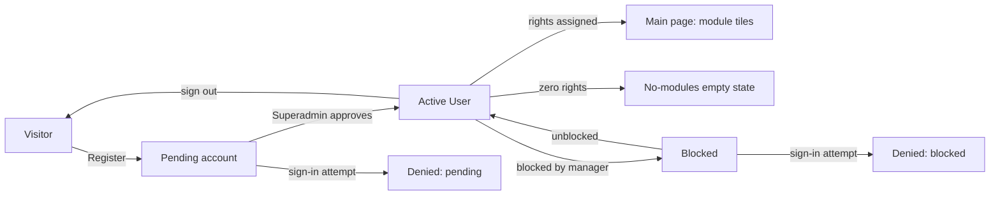
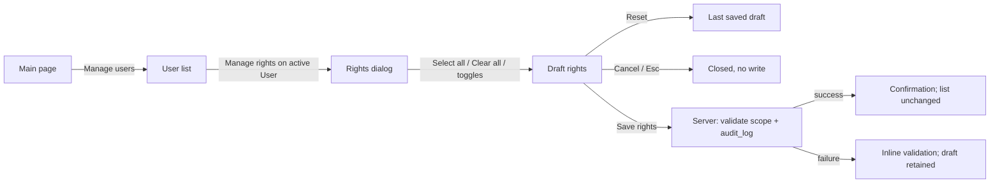

# S1-UIX-04: Hi-fi Mockups and Developer Handoff Notes

**Issue:** [#17 — S1-UIX-04](https://github.com/jamesseno/Clinic-Squad---HOPE-Inc.-Midterm-Project/issues/17)  
**Role / Sprint:** UI/UX Designer | Sprint 1  
**Fidelity:** High. Final visual language, component specs, states, and implementation notes. Presentation-only prototype: no authentication, authorization, persistence, or audit writes occur.

## Deliverables

| Deliverable | File |
|---|---|
| Hi-fi mockups (all five views, interactive) | [`UI/UX/hi-fi/s1-uix-04.html`](../../UI/UX/hi-fi/s1-uix-04.html) |
| Hi-fi visual system | [`UI/UX/hi-fi/s1-uix-04.css`](../../UI/UX/hi-fi/s1-uix-04.css) |
| Prototype interactions | [`UI/UX/hi-fi/s1-uix-04.js`](../../UI/UX/hi-fi/s1-uix-04.js) |
| Developer handoff notes (this file) | [`docs/ui-ux/s1-uix-04-hifi-handoff.md`](./s1-uix-04-hifi-handoff.md) |

Open `UI/UX/hi-fi/s1-uix-04.html` in a browser. The dark strip at the top is **prototype chrome, not product UI**: it switches views, previews the signed-in role, and forces loading/error/empty states. Hover and keyboard focus states are produced by pointing at or tabbing through real controls.

---

## 1. Design system contract

The hi-fi uses the **merged Hope UI design system** in [`UI/UX/style.css`](../../UI/UX/style.css) (S1-UIX-01). `s1-uix-04.css` mirrors those variable names and values one-to-one so the mockups and the Next.js app share one visual language. One accessibility derivative is added: `--muted-text` is a slightly darker version of `--muted` used for text so it clears WCAG AA on both app surfaces. Semantic status colors are carried forward from the S1-UIX-03 wireframe palette and retinted to the warm Hope neutrals. Derived spacing/radius/focus tokens are prototype conveniences documented below.

### Color tokens

| Token | Value | Use |
|---|---|---|
| `--ink` | `#342a39` | Primary text, headings, dark surfaces |
| `--muted` / `--muted-dark` | `#7d7480` / `#5e5362` | Source muted tokens from S1-UIX-01 |
| `--muted-text` | `#786f7b` | Contrast-adjusted derivative used for secondary text: 4.54:1 on `--page`, 4.77:1 on `--surface` |
| `--purple` / `--purple-dark` | `#695172` / `#503c58` | Primary action, active nav, focus tint, links |
| `--purple-soft` | `#f1eaf2` | Active nav fill, icon wells, selected pagination |
| `--gold` | `#b88d53` | Brand punctuation, attention accents |
| `--green` | `#71896d` | Brand accent; positive change text |
| `--pink` | `#c4778c` | Reserved brand accent |
| `--line` | `#e9e2dd` | Borders, dividers, table rules |
| `--surface` / `--page` | `#fffefa` / `#faf8f3` | Cards / application background |
| `--success` / `--success-soft` | `#32735b` / `#e9f4ed` | Active status, operational banner, success feedback |
| `--warning` / `--warning-soft` | `#8a641c` / `#fbf3dd` | Pending status, attention card, count chips |
| `--danger` / `--danger-soft` | `#a64e4e` / `#faebeb` | Blocked status, validation errors, destructive actions |

### Typography

| Role | Family / weight | Size | Line height |
|---|---|---|---|
| Page title (h1) | Cormorant Garamond, 600 | 34px (28px mobile) | 1.15 |
| Card / section title (h2) | Cormorant Garamond, 600 | 20px | natural |
| Subsection title (h3) | Cormorant Garamond, 600 | 15px | natural |
| Auth hero | Cormorant Garamond, 600 | clamp(44–66px) | 1.04 |
| Body | DM Sans, 400 | 15px (13px dense UI) | 1.55 |
| Field label / button | DM Sans, 700 | 13px | natural |
| Hint / helper / badge | DM Sans, 400–700 | 10–11px | 1.4 |
| Eyebrow | DM Sans, 700, uppercase, 1.5px tracking | 10px | natural |

### Spacing, shape, elevation

| Token | Value | Typical use |
|---|---|---|
| `--space-1 … --space-12` | 4, 8, 12, 16, 20, 24, 32, 40, 48px | 4px grid; 16/20/24px card padding; 16px card gaps |
| `--radius-sm/md/lg` | 6 / 8 / 12px | Inputs & chips / cards & buttons / auth card & dialog |
| `--radius-pill` | 999px | Status badges |
| `--shadow-card` | `0 18px 55px rgb(65 49 63 / 9%)` | Auth card, elevated surfaces |
| `--shadow-raised` | `0 8px 18px rgb(105 81 114 / 18%)` | Primary buttons |
| `--shadow-modal` | `0 24px 70px rgb(40 31 48 / 30%)` | Rights dialog |
| Focus ring | `3px solid rgb(105 81 114 / 45%)`, 2px offset; `0 0 0 3px rgb(105 81 114 / 18%)` on input wraps | Keyboard focus |

### Core component specs

| Component | Spec | States |
|---|---|---|
| Primary button | min-height 44px, radius 8px, 13px/700, purple fill, 20px horizontal padding, arrow affordance | default, hover (`--purple-dark`, −1px lift), focus ring, loading (spinner replaces arrow), disabled (0.65 opacity, not-allowed) |
| Secondary button | Same geometry, 1px `--line` border, surface fill | hover: purple border + `--purple-soft` fill |
| Text / link button | 11–13px/700 purple, no chrome | hover: underline with 3px offset + soft fill |
| Text input | 46px height, radius 8px, 1px `--line`, 13px text, 12px padding | hover border darkens, focus border purple + 3px ring, invalid = danger border and tinted fill, placeholder `#b0adba` |
| Checkbox | Auth: 16px, 4px radius, purple accent. Permissions: 24px native targets with 12/16px grid spacing. Labels always clickable. | unchecked, checked (white check), focus ring on adjacent box, invalid danger border, indeterminate module header |
| Status badge | Pill, min-height 23px, 10px/700, soft fills | Active / Pending / Blocked |
| Data table | 10px uppercase headers, 13px cells, 12×15px padding, 1px row rules, sticky-free scroll wrapper | hover row tint, horizontal scroll ≤680px, loading overlay, empty panel |
| Dialog | 780px max, ≤90vh, radius 12px, scrollable, sticky header, 48% backdrop | open, focus trapped by native `<dialog>`, Esc / Cancel / close button |
| Feedback | Inline `.form-feedback` under forms, `.field-error` per field, toast bottom-right | neutral, error (danger tint), success (success tint); all `role="status"` / `aria-live` |

---

## 2. Screen-by-screen specifications

### 2.1 Login — `/login`

**Hierarchy:** Brand story on the left (hero → assurance → footnote) and the auth card on the right. The card title is the primary focus; helper links are secondary; the submit button is the only filled control.

| Element | Type | Required | Behavior / notes |
|---|---|---|---|
| Email address or username | Text input, `autocomplete="username"` | Yes | Invalid → field error + summary. Server resolves identifier to an account; never trust a client-supplied role. |
| Password | Password input, `autocomplete="current-password"` | Yes | Eye icon toggles type and updates `aria-label` / `aria-pressed`. |
| Forgot password? | Link button | — | Routes to the reset flow already specified in [S1-UIX-02 wireframes](../../UI/UX/index.html); out of scope for the five hi-fi views. |
| Remember me | Checkbox | No | Maps to session persistence configuration, not a role or permission. |
| Log in | Primary submit | — | Loading spinner → success feedback with route to Main page, or account-state error. |
| Create an account | Link button | — | Switches to Register. |
| Feedback region | `role="status" aria-live="polite"` | — | Inline neutral/error/success message; field errors are also linked via `aria-describedby`. |

**States:** default; hover/focus on inputs, toggles, links, button; loading (button spinner, disabled); error (invalid credentials, pending account, blocked account); success (preview confirms sign-in). No empty state applies.

**Layout:** Two-column `minmax(0,1fr) / minmax(390px,460px)` inside a 1180px container, vertically centered, 650px minimum height. ≤820px stacks the story above a max-540px card; ≤680px uses 16px page padding and full-width card.

---

### 2.2 Register — `/register`

**Hierarchy:** Same split layout as Login. The card is taller; the field order follows the account lifecycle: identity → contact → credential → consent → action.

| Field | Type | Required | Rule |
|---|---|---|---|
| Full name | Text, `autocomplete="name"` | Yes | Non-empty. **Implementation must split into `first_name` and `last_name`** for `public.app_user`; alternatively split the field in the UI to match `TC-AUTH-01`. |
| Email address | Email, `autocomplete="email"` | Yes | Valid email format; case-insensitive uniqueness enforced by `app_user_email_lower_unique` and RLS. Duplicate → inline error. |
| Phone number | Tel, `autocomplete="tel"` | No | Display-only in this mockup; persist only if a column is added. |
| Create a password | Password, `autocomplete="new-password"` | Yes | Minimum 8 characters; visible hint; show/hide toggle. |
| Confirm password | Password, `autocomplete="new-password"` | Yes | Must match password; checked live and on submit. |
| Terms and Privacy Policy | Checkbox | Yes | Must be accepted before submit. |
| Request account | Primary submit | — | Loading → "account pending" confirmation. No role is self-assignable. |
| Log in (switch) | Link button | — | Returns to Login. |

**States:** default; hover/focus; validation (all highlighted fields + summary); duplicate-email error; loading; success/pending confirmation.

**Edge cases:** privilege escalation payloads must be rejected server-side — inserted profiles are always `role = user`, `account_status = pending`, `is_blocked = false` (see `20261119084800_app_user_roles_modules_and_permissions.sql` and `TC-AUTH-03`).

**Layout:** Same breakpoints as Login; card padding tightened to 24px vertical on small screens.

---

### 2.3 Main Page — `/`

**Hierarchy:** Greeting and workspace date → four summary cards → module grid (primary task area) with an attention rail (secondary) → prototype footnote. Module tiles are the largest click targets in the content region.

| Element | Behavior / notes |
|---|---|
| Sidebar: Overview | Current page; `aria-current="page"`. |
| Sidebar: module links | Customers, Products, Human Resources, Sales, Reports — shown only when the signed-in user holds rights for that module; hidden for zero-rights state. |
| Sidebar: User management / Audit log | Admin-only; hidden for standard users. Audit log is a later destination; Sprint 1 requires the audit write, not the screen. |
| Sidebar: user card + Log out | Role label reflects the session; Log out ends the session and returns to Login. |
| Topbar | Breadcrumb, "All systems operational" status pill, avatar, name and role. |
| Summary cards | Active users, Pending approvals (admin-only), Modules available (derived from rights), Last data sync. Counts are illustrative in the prototype; production must derive them from permitted data. |
| Module tiles | Five tiles with icon initials, name, one-line description, arrow. Filtered by server-side rights; direct routes must still be denied. |
| No-modules empty state | "No modules assigned / Ask an administrator to review your account rights." Valid state, not an error. Count reads `00`. |
| Attention rail | Pending approvals → User management; Recent access changes; Workspace status; Manage users primary action. Admin-only. |

**States:** default; hover/focus lift on tiles and arrow buttons; no-modules empty state; admin vs. user role scoping. Loading is handled by the app shell/suspense boundary in production, not by the static mockup.

**Layout:** Sidebar 232px + fluid content ≤1240px. ≤980px sidebar becomes a 76px icon rail and the dashboard stacks to one column with a 2×2 summary grid. ≤680px sidebar becomes a horizontal icon bar; summary and module grids become single-column; admin-only rail is hidden on small screens.

---

### 2.4 User Management — `/users`

**Hierarchy:** Page title and Add User action → list card (summary + tabs + filters + table + footer) → scope note. The table is the primary work area; preview controls are prototype-only.

| Control | Type / options | Behavior / notes |
|---|---|---|
| Add User | Primary button | Opens the account-creation form in the connected app. |
| Status tabs | All / Pending / Active / Blocked with counts | Single-select (`aria-pressed`); resets page to 1. |
| Search | Search input | Debounce in production; matches name or email; resets page to 1. |
| Role filter | All roles / User / Admin / Superadmin | Combined with status tab and search. |
| Sort by | Name A–Z / Recently added / Role | Client sorting in prototype; server sorting/pagination in production. |
| Table columns | Name, Email, Role, Status, Last active, Actions | 13px cells; long values truncate or scroll; `caption.sr-only` describes the table. |
| Row actions | Approve, Edit, Block/Unblock, Manage rights, Protected | See permission matrix below. Disabled buttons carry explanatory `title` and are never the sole enforcement. |
| Rows per page / pagination | 5 or 10; numbered pages with prev/next | Clamp current page when result count shrinks; `aria-current="page"`. |
| Loading state | Spinner + skeleton line, `role="status"` | Replaces table body while fetching. |
| Empty state | Icon, "No users found", Clear filters | Shown for no matches or the forced zero-results preview. |
| Scope note | Text | States the manager's visibility scope. |

**States:** default; hover/focus on rows, tabs, filters, actions, pagination; loading; empty/no-match; admin scope (elevated rows excluded); status changes reflected in tab counts and badges.

**Layout:** Table scrolls horizontally inside `.table-wrap` below 680px (780px minimum table width). Filters wrap; tabs scroll horizontally; footer wraps with pagination right-aligned.

---

### 2.5 Rights Dialog — opened from `/users`

**Hierarchy:** Sticky header with selected-user context → bulk actions → five permission fieldsets → guardrail notes → Cancel/Save. The user context and the module counts (`n/7`, `n/8`) make the target of every toggle unambiguous.

| Element | Behavior / notes |
|---|---|
| Header | Name · email · account status/role; close button. |
| Select all / Clear all | Sets all 36 rights on/off; updates module header checkboxes and counts. |
| Reset | Returns the draft to the last saved values (not to the original open state after a save). |
| Module checkbox | Selects/clears that module's rights; `indeterminate` for partial selection; `aria-label="Select all <module> rights"`. |
| Per-action checkboxes | 36 rights: Customers 7, Products 7, Human Resources 7, Sales 7, Reports 8. Labels must be reconciled with the final `rights_catalog` seed before implementation. |
| Guardrail notes | Admin scope, pending/blocked restriction, zero-rights validity, audit attribution. |
| Validation region | `role="status"`; blocks save for ineligible accounts or failed writes. |
| Cancel / × / Esc | Closes without saving; draft discarded. |
| Save rights | Loading spinner → commit → toast; server must write an `audit_log` row with the acting manager, timestamp, and old/new values. |

**States:** default (two illustrative rights per module), partial selection, saving, save error, cancel-without-save, reset-to-saved, zero rights (all cleared — valid). Native `<dialog>` provides focus trapping and Escape handling.

**Layout:** Two-column fieldset grid; permission lists are two-column inside each fieldset. ≤680px: dialog becomes near-full-width, single-column fieldsets, toolbar stacks, permission lists single-column below 400px.

---

## 3. User flows and state transitions

### 3.1 Access lifecycle

### 3.2 Manager rights flow

### 3.3 State matrix

| View | State | Trigger | Visual | Exit / next state |
|---|---|---|---|---|
| Login | Error | Wrong credentials, pending or blocked account | Field error + summary | Correct input → loading → success |
| Login | Loading | Valid submit | Spinner, disabled button | Feedback + Main page route |
| Register | Validation | Missing/invalid fields | Per-field errors + summary | Correction → loading → pending success |
| Register | Success | Valid submit | "Pending approval" confirmation | Await manager approval |
| Main | No modules | Zero assigned rights | Empty panel, count `00` | Rights granted by manager → tiles return |
| Users | Loading | Fetch in flight | Spinner + skeleton | Rows or empty state |
| Users | Empty | No search/filter matches | Empty panel + Clear filters | Cleared filters → default |
| Rights | Partial | Some actions in a module checked | Indeterminate module box, `x/y` count | Select all / clear / save |
| Rights | Saving | Save clicked | Button spinner | Closed + toast, or inline error |
| Rights | Error | Ineligible target / failed write | Validation message | Retry or Cancel |

---

## 4. Frontend implementation notes

### 4.1 Validation rules

| Surface | Rule | Feedback |
|---|---|---|
| Login | Identifier and password required; server verifies credentials **and** `account_status = active`, `is_blocked = false` | Field error for shape/sign-in failure; account-state message for pending/blocked |
| Register | Name required; valid email; password ≥8 chars; confirm match; terms accepted | Inline field errors plus a summary; duplicate email handled server-side |
| User management | Role/status transitions constrained by manager role; last active Superadmin cannot be blocked, demoted, or disabled | Toast/banner on rejection; server is authoritative |
| Rights | Only active standard `User` targets; all rights must exist in `rights_catalog` | Inline validation; no partial write on failure |

Never trust values supplied by the browser: role, approval status, and rights must be rechecked in server actions and Supabase RLS. The prototype's role selector only changes what is drawn.

### 4.2 Permissions / access control behavior

| Action | Superadmin | Admin | User |
|---|---|---|---|
| View Main page / own modules | Yes | Yes | Yes (rights filtered) |
| View User management | Yes | Yes | No — redirect / 403 |
| See Admin & Superadmin rows | Yes | No (hidden) | n/a |
| Approve pending, designate admins | Yes | No | No |
| Add / edit / block users | Yes | Standard Users only | No |
| Open Rights dialog | Active Users (and other managed accounts, subject to server scope) | Active standard Users only | No |
| Manage own rights | Server-controlled | Server-controlled | No |
| Access a module route without the right | Denied server-side | Denied server-side | Denied server-side |

Enforcement follows `app_private.current_role_code()` and `can_manage_user()` plus the RLS policies in the access-control migration. Hide or disable UI affordances for clarity, but always pair them with server checks (see `S1-TST-04`/`TC-UM-05`, `TC-MAIN-02`). Active sessions must be invalidated when an account is blocked.

### 4.3 Feedback and confirmation states

- **Inline field errors** are attached with `aria-describedby` and `aria-invalid`; a nearby summary announces the failure. Do not rely on color alone.
- **Loading** disables the triggering control and shows a spinner; list fetches replace the table with a live-region spinner.
- **Success** confirmations are specific: "account pending", "rights saved", "user approved". Destructive actions (block, revoke rights) should use a confirmation step in production even though the mockup applies them immediately for preview.
- **Audit**: every rights change must log actor, timestamp, and old/new values; the UI must never fabricate an actor identity.
- **Toasts** are announcements, not the only record of success — the underlying list/badge state must update too.

### 4.4 Accessibility and usability

- Semantic landmarks: `header`, `nav`, `main`, `aside`, `section`, `table` with `caption`, native `dialog` with `aria-labelledby`.
- Visible `:focus-visible` ring on every interactive control; logical tab order; Enter/Space activation; Escape closes the dialog.
- Every input has a persistent visible `<label>`; icon-only buttons have `aria-label`; toggle buttons expose `aria-pressed`; tabs use `aria-pressed`; current navigation uses `aria-current="page"`.
- Errors use text plus icons/borders, not color alone; live regions use `role="status"` / `aria-live="polite"`.
- Skip link, 320px minimum width, touch targets ≥28px (44px for primary actions), reduced-motion media query, and system font fallbacks.
- Keep contrast: `--purple` on `--surface`, `--ink` on `--page`, status colors on their soft fills. The hi-fi uses `--muted-text` for all secondary text and 24px checkbox targets; Lighthouse accessibility is 1.00 on all five views. Re-check after any token or label change before shipping.
- Do not auto-focus destructive actions. On view changes, focus moves to the new view's heading or first input.

### 4.5 Data mapping and open decisions

| Mockup label | Backend mapping / decision |
|---|---|
| Full name | Split to `first_name` + `last_name` on submit, or split the field in production UI to match `TC-AUTH-01`. |
| Email address or username | Backend resolves identifier to one canonical `email`; do not add username support without a schema decision. |
| Phone number | Not present in the current schema; omit from the POST unless a column is added. |
| Account status / blocked | `app_user.account_status` (`pending`/`active`) and `app_user.is_blocked`. |
| Module rights | `rights_catalog` + `user_permission` with soft delete; module visibility from `module.display_order`. |
| 36 action labels | Confirm exact wording/grouping against the seeded `rights_catalog` before wiring checkboxes. |
| Sidebar vs top navigation | Hi-fi adopts the sidebar required by `S1-DEV-08`; the S1-UIX-03 wireframe's top bar is retained for user context only. Confirm with the developer before implementation. |

---

## 5. Verification and deliverable evidence

- [x] Hi-fi mockups provided for Login, Register, Main Page, User Management, and Rights Dialog.
- [x] Developer handoff notes cover components, fields, actions, layout, flows, states, edge cases, validation, permissions, feedback, and accessibility.
- [x] Interaction preview covers validation/loading/success, no-modules, no-match, admin scope, indeterminate rights, reset, cancel, and save feedback.
- [x] Browser verification at the available fixed 626×488px viewport (mobile breakpoint ≤680px) of all five views and forced states completed: login error/pending/blocked/loading, register validation/duplicate/loading/success, no-modules, list loading/empty/search, rights partial/saving/error, zero/all rights, role scoping, and dialog close-on-navigation. No console errors or warnings; no horizontal page overflow.
- [x] Lighthouse: accessibility 1.00, best practices 1.00, SEO 1.00 on all five views. Initial contrast and permission-checkbox target-size findings were fixed with `--muted-text` and 24px checkbox targets.
- [x] `node --check UI/UX/hi-fi/s1-uix-04.js`, `npm run typecheck`, and `npm run lint` pass. Lint reports one pre-existing `no-page-custom-font` warning in `app/layout.tsx`, unrelated to these deliverables.
- [ ] Responsive breakpoints visually verified at 1120/980/820/400px widths in a resizable browser. The 680px breakpoint was exercised in the available viewport; all six media-query blocks are parsed in the stylesheet.
- [x] Non-trivial PR opened: [#138](https://github.com/jamesseno/Clinic-Squad---HOPE-Inc.-Midterm-Project/pull/138) from `feat/issue-17-hifi-handoff` (commit `c210c52`).
- [ ] PR reviewed and approved by a teammate.
- [ ] PR merged into `main` after approval.

### Suggested PR body

> Related issue: #17
>
> Adds high-fidelity Sprint 1 mockups for Login, Register, Main Page, User Management, and the Rights Dialog, plus developer handoff notes. The standalone preview uses the merged Hope design system tokens from `UI/UX/style.css`, includes interactive loading/error/empty/validation states and role scoping, and documents validation rules, permission behavior, audit expectations, accessibility details, and open data-mapping decisions.
>
> Files: `UI/UX/hi-fi/s1-uix-04.{html,css,js}` and `docs/ui-ux/s1-uix-04-hifi-handoff.md`.
>
> Prototype only — no authentication, authorization, persistence, or audit writes are performed.

### Suggested issue comment

> S1-UIX-04 handoff is up for review: [hi-fi preview](../../UI/UX/hi-fi/s1-uix-04.html) and [developer handoff notes](./s1-uix-04-hifi-handoff.md). All five required views are included, with state previews and responsive behavior. Please review the token mapping, the 36-rights labels, and the Full-name → first/last-name data mapping before implementation. Verification evidence is recorded in the handoff doc; teammate approval and merge are still pending.
