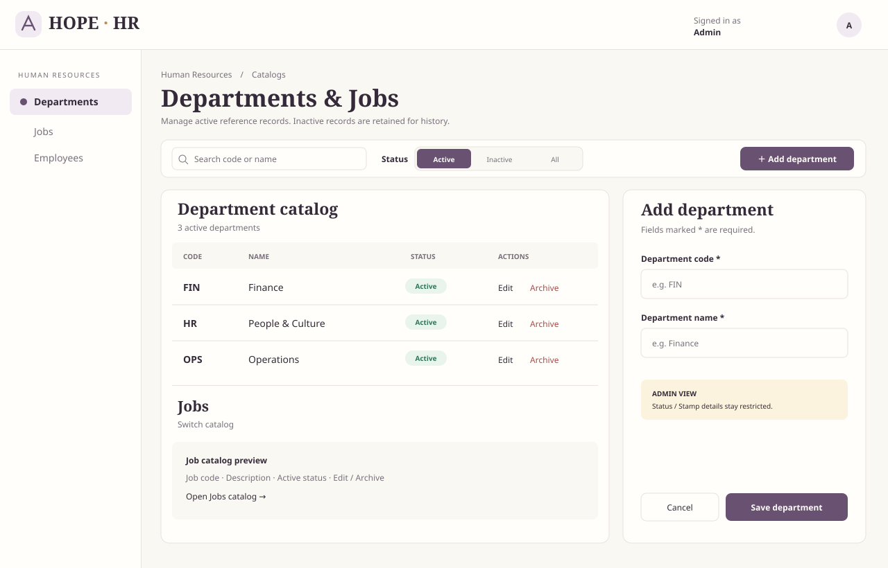

# S3-UIX-01 — Department and Job wireframe handoff

**Issue:** [#76](https://github.com/jamesseno/Clinic-Squad---HOPE-Inc.-Midterm-Project/issues/76)

**Fidelity:** Proposed static SVG screen mockup; not an implemented app screen.
**Scope:** Department and Job catalogs, Admin/User visibility, active/inactive filtering, create/edit, soft-delete, restore.

## Viewable mockup

[Open the Department and Job SVG mockup](./s3-issue-76-department-job-mockup.svg).



## Current UI versus proposed design

**Implemented now:** `/departments` and `/jobs` already render searchable tables, permitted add/edit/delete/restore controls, a “Show deleted” toggle when allowed, and compact inline forms. Their rows expose a Deleted status and dim deleted records. The current controls do not offer the requested explicit Active / Inactive / All filter, and their tables/forms are unstyled native layouts.

**Proposed handoff:** Replace the single deleted toggle with a status filter and clear list/form hierarchy below. These are design requirements, not claims that current screens already follow them. The Student Guide sections cited by the issue were not found in this checkout; validate the labels and exact right names against the team’s approved guide/catalog before implementation.

## Readable wireframe

```text
┌ Hope shell: HR navigation / signed-in role ───────────────────────────┐
│ Human Resources  /  Departments                 [ + Add department ] │
│ Search [ code or name … ]     Status [ Active ▾ ]     [Clear filters]│
│ Showing active departments                                           │
│ Code     Name                         Status      Actions             │
│ FIN      Finance                      Active      View  Edit  Archive │
│ …                                                                     │
│ [Previous]                         Page 1 of N             [Next]     │
└───────────────────────────────────────────────────────────────────────┘

Add/edit panel (inline at desktop; full-screen sheet on narrow screens)
  Department code* [____]   Department name* [________________]
  [Cancel] [Save department]

Admin status options: Active | Inactive | All
User status view: Active records only; no inactive filter or restore controls
```

Jobs use the same structure with **Job code** and **Description**. Keep the two catalog screens visually parallel; label the active state “Active” and the soft-deleted state “Inactive (archived)” in the admin view, with a text status as well as color.

## Flow and field rules

1. Open a catalog from HR navigation. The list initially shows Active records.
2. Search by code or name/description; combine search with the Admin status filter. “Clear filters” returns to Active and clears the query.
3. **Add** opens a labeled form. Department: code (required, max 3 per current UI), name (required, max 20). Job: code (required, max 4), description (required, max 20). Confirm limits with the schema before treating them as permanent.
4. **Edit** opens the same form with the code displayed as read-only; only name/description is editable, matching current behavior.
5. **Archive** confirms the record and explains it becomes inactive rather than permanently erased. After success, show a status announcement and refresh the list. **Restore** is available only for inactive rows to a right-bearing Admin.

## Role and rights matrix

| Action | Admin with corresponding right | User / no right |
|---|---|---|
| Browse/search Active catalog | Show permitted records | Show active records only |
| Browse Inactive / All | Show only with deleted-record visibility right | Hide filter and inactive records |
| Add / Edit | Show each control only when its matching right is present | Hide unauthorized controls |
| Archive (soft delete) | Show for active row only when delete right is present; confirm | Hide |
| Restore | Show for inactive row only when restore right is present | Hide |
| Status/Stamp metadata | Admin-only; compact “Inactive” plus audit metadata in row detail | Do not expose |

Do not treat hidden controls as authorization. The API and database policies must independently authorize reads and mutations. Do not expose deleted-row details to users who cannot view them.

## States, privacy, and accessibility

- **Loading:** table skeleton and “Loading departments/jobs…” status.
- **Empty catalog:** “No active departments/jobs yet” with Add only if allowed.
- **No matches:** “No records match these filters” and Clear filters.
- **Save/validation error:** keep draft, associate field errors with fields, focus the first invalid field; announce server/network error without clearing form.
- **Save success:** inline polite status; close form and refresh.
- **Inactive row:** explicit status label, not opacity alone. Disable/hide edit and archive; show Restore only if permitted.
- **Privacy:** catalogs contain organizational records; still restrict audit Stamp and inactive records to the relevant administrative rights. Avoid exposing actor metadata in user view.
- **Keyboard/screen reader:** semantic heading, labeled search/select, table caption and scoped column headers, real buttons, visible focus, 44px targets, clear focus order. Confirm archive with a labeled dialog; Escape/cancel does not mutate.
- **Responsive:** wide table scrolls within a named region; at phone width render each row as a stacked labeled card and keep actions reachable, with filters wrapping and form controls full width. Do not require color or hover.

## Developer handoff

**Implementing issues:** [#77 — Department list and CRUD](https://github.com/jamesseno/Clinic-Squad---HOPE-Inc.-Midterm-Project/issues/77), [#80 — Job list and CRUD](https://github.com/jamesseno/Clinic-Squad---HOPE-Inc.-Midterm-Project/issues/80).
Reuse the same catalog pattern; resolve exact rights and statuses against the policy/schema. This document proposes presentation and interaction only; trusted API/RLS enforcement remains required.
