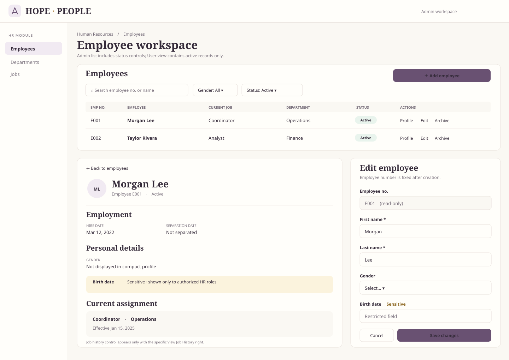

# S3-UIX-02 — Employee list and profile wireframe handoff

**Issue:** [#79](https://github.com/jamesseno/Clinic-Squad---HOPE-Inc.-Midterm-Project/issues/79)

**Fidelity:** Proposed static SVG screen board; not an implemented app screen.
**Scope:** Employee list variants, add/edit form, individual profile, privacy, and conditional job-history entry point.

## Viewable mockup

[Open the Employee list, profile, and form SVG mockup](./s3-issue-79-employee-profile-mockup.svg).



## Current UI versus proposed design

**Implemented now:** `/employees` has search, gender filter, an optional “Show deleted” toggle, a list, add/edit form and in-place profile view. The list’s Profile action is currently available to every returned row; the profile displays gender, hire/separation status and a job-history table. Salary is masked unless the current permission flag allows it. Birth date is collected by the employee form but is not shown on the profile. The current UI does not clearly distinguish Admin and User list variants or provide a dedicated “View Job History” access gate.

**Proposed handoff:** Use separate Admin/User field and action visibility as below. Treat permission flags from trusted server logic as data for presentation only; direct endpoints must enforce access. No Student Guide file was present in the checkout, so confirm labels and exact right names with the approved guide.

## Readable wireframes

```text
Admin: Human Resources / Employees                    [ + Add employee ]
Search [ employee no. or name … ] Gender [All ▾] Status [Active ▾]
┌ Employee no. | Name | Current job | Department | Status | Actions ┐
│ E001          | …    | …           | …          | Active | Profile…│
└───────────────────────────────────────────────────────────────────┘

User: Human Resources / Employees
Search [ employee no. or name … ] Gender [All ▾]
┌ Employee no. | Name | Current job | Department | Actions ┐
│ E001          | …    | …           | …          | View   │
└───────────────────────────────────────────────────────────┘

Profile: ← Employees
Name · Employee no. · Active/Separated
Employment: Hire date | (authorized) separation date
Personal: Gender | Birth date [restricted]
Current assignment: Job · Department · Effective date
[View job history] (only with the specific view right)
```

## Flow and data

1. Search/filter the list. Admin can select Active / Inactive / All only when permitted to view soft-deleted records; Users see active employees only.
2. Admin’s **Add employee** form collects Employee No. (required on create), First Name, Last Name, Gender, Birth Date, Hire Date, and optional Separation Date as a status-changing field if allowed. On edit, Employee No. is immutable. Confirm requiredness/limits with schema; existing UI currently requires name, gender and date inputs are optional.
3. Open an employee profile from a row. The profile keeps the employee identity in its heading and separates personal fields from employment/assignment fields.
4. Show the **View Job History** link only when that right is granted. If absent, do not fetch or render history. If present, open the history view described by issue #83.
5. Admin edit/archive/restore actions appear only with respective rights. Archive requires confirmation and communicates soft-delete; do not imply permanent erasure.

## Role and rights matrix

| Field/action | Admin with right | User / no right |
|---|---|---|
| Employee No., name, current job/department | Show records allowed by HR read scope | Show only active fields authorized by HR read scope |
| Gender, birth date, hire date | Show only if Employee view permits; birth date marked sensitive | Omit birth date unless specifically permitted |
| Separation date and inactive status | Admin-only in list/profile | Do not reveal inactive/separated rows or admin status metadata |
| Add/Edit/Archive/Restore | Each action requires its corresponding server-issued right | Hide unauthorized actions |
| View Job History | Show only with **View Job History** | Hide link, history table and associated salary data without the right |
| Salary | Hide in list/profile unless the separate salary right permits it | Never infer permission from profile access |
| Status/Stamp | Admin-only | Omit |

## States, privacy, accessibility, responsive

- Loading: skeleton rows/profile with a live “Loading employees…” message.
- Empty data vs. no filter matches have different copy; offer Clear filters only for the latter.
- Unauthorized profile/history: show a neutral access-denied state, not partial sensitive values. Expired session returns to sign-in.
- Validation: inline, field-associated errors; invalid dates (for example hire date after separation date) retain the draft and explain the correction. Server conflict/network errors remain visible and retryable.
- Deleted/separated: distinct text badges and dates; not dim color alone. Restore follows confirmation/feedback.
- **Privacy:** birth date and salary are sensitive; do not put either in list rows, URLs, analytics, client-side logs, or print affordances by default. Mask salary unless explicit salary-view permission exists. Apply least privilege to request payload and fetched response, not just CSS.
- Semantic form labels, required/optional wording, fieldset for employment details, table caption/headers, visible focus, keyboard-operable controls and polite status/live errors. Make labels explain why a field is unavailable rather than showing an ambiguous blank.
- Desktop uses a compact data table. At narrow widths convert each employee row into a labeled card; profile sections stack, actions wrap, and dates/long names remain readable without horizontal page scrolling.

## Developer handoff

**Implementing issues:** [#84 — Employee list with search and filter](https://github.com/jamesseno/Clinic-Squad---HOPE-Inc.-Midterm-Project/issues/84), [#88 — Employee create and edit form](https://github.com/jamesseno/Clinic-Squad---HOPE-Inc.-Midterm-Project/issues/88), [#91 — Employee soft delete/restore and separation date](https://github.com/jamesseno/Clinic-Squad---HOPE-Inc.-Midterm-Project/issues/91), [#96 — Employee profile with job timeline](https://github.com/jamesseno/Clinic-Squad---HOPE-Inc.-Midterm-Project/issues/96).
History gating and salary redaction are further specified in [#100](https://github.com/jamesseno/Clinic-Squad---HOPE-Inc.-Midterm-Project/issues/100). This is a presentation handoff, not an authorization design.
