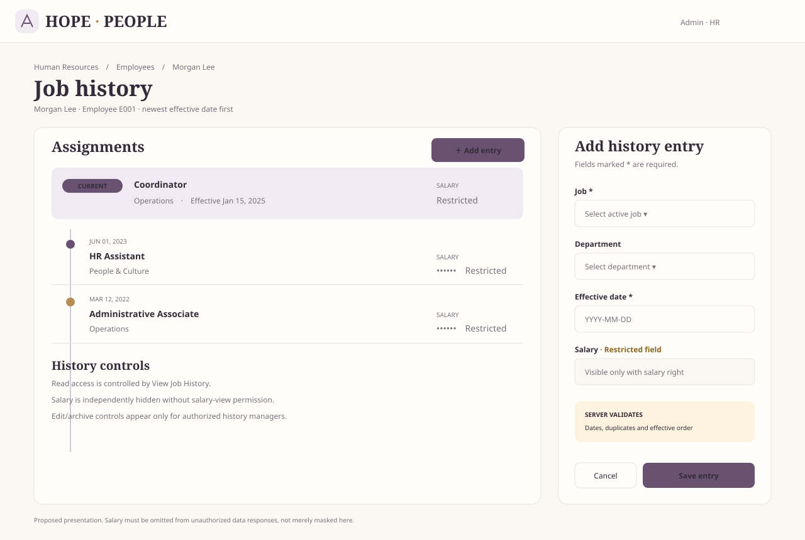

# S3-UIX-03 — Job history timeline wireframe handoff

**Issue:** [#83](https://github.com/jamesseno/Clinic-Squad---HOPE-Inc.-Midterm-Project/issues/83)
**Fidelity:** Proposed static SVG timeline mockup; not an implemented app screen.

## Viewable mockup

[Open the Job History SVG mockup](./s3-issue-83-job-history-mockup.svg).



## Current UI versus proposed design

**Implemented now:** Job History is embedded in the Employee profile page as a table with Effective Date, Job, Department, Salary and Actions. An Add Entry form accepts job code, effective date, salary and department code. The current profile page masks salary unless `canViewSalary` is true and gates Add/Delete controls behind `canManageJobHistory`; its rendered table does not identify the current position, and this UI does not explicitly signal chronological order or expose an Edit control.

**Proposed handoff:** Use an ordered history timeline/table, explicit current assignment marker, and separate view/manage/salary rights. Do not treat this proposal as evidence that the present screen already satisfies those requirements.

## Readable wireframe

```text
Employee: [name] · [employee no.]                    [Back to profile]
Job history                                              [ + Add entry ]*
Current assignment  (latest effective active entry)
  [effective date] — [job title] · [department]
  Salary: [shown only with salary right]
Past assignments  (newest to oldest)
  [date] — [job] · [department] · Salary [masked/shown]    [Edit]* [Archive]*
  [date] — …
* Actions appear only when permitted.
```

Use dates in a locale-aware, unambiguous format; sort newest effective date first; label the latest valid, non-deleted assignment “Current.” Preserve the effective date on each row so current/past status is understandable without relying on position alone.

## Flow and entry fields

1. Only a user granted **View Job History** can open the section. Without it, do not request history from the API.
2. **Add entry** opens a labeled form: Job (select from permitted job catalog), Department (optional/select from permitted active departments if supported), Effective date (required), Salary (sensitive; required only if product rules require it).
3. Validate dates and duplicates with the server; display conflict feedback inline without discarding the draft.
4. Edit or archive only with the respective history-management right. Deletion is a soft-delete if that is the data model; show inactive entries only to users with the deleted-history view right. Restore is separately authorized where supported.
5. On save, refresh history and recompute which position is current. Do not let a stale client determine current role or overwrite an effective record silently.

## Role/right behavior and privacy

| Capability | Behavior |
|---|---|
| View history | Gate the entire section and request by the specific View Job History right (#100). |
| View salary | Independently gate salary column, form values and report data; replace with “Restricted”/omit, never show a value in tooltips or screen-reader-only text. |
| Add/edit/archive | Require specific history mutation rights; hide actions when absent. Explain “View only” in a short section note. |
| Deleted history | Admin-only when the deleted-row view right permits; show an Inactive label and permitted Restore action only. |
| Audit fields | Status/Stamp and actor metadata remain administrative and are not part of ordinary user history. |

Salary and employment history are sensitive personnel data. Restrict server/API response, cache, exported/printed views and logs in addition to the visual presentation. Never assume a hidden salary cell is protected.

## States and accessibility

- Loading history; empty history (“No job history recorded”); no accessible history (neutral no-access message); unavailable history error with Retry; no job options; invalid/missing effective date; duplicate-date conflict; save/delete success and failure.
- Identify current vs. past using text and an icon/border treatment, not color alone. A row deleted or archived must not silently become current.
- Use a semantic ordered list or table with caption and column headers. Every entry action has an accessible name including the effective date. Forms have explicit labels, error descriptions, keyboard order, visible focus and `aria-live` save feedback.
- On mobile, show stacked assignment cards with date/job/department/salary labels and a visible current marker. Keep salary label/value in a separate permission-gated block; avoid a wide horizontal timeline that requires drag gestures.

## Developer handoff

**Implementing issues:** [#93 — Job history add/edit/delete](https://github.com/jamesseno/Clinic-Squad---HOPE-Inc.-Midterm-Project/issues/93), [#96 — Employee profile with job timeline](https://github.com/jamesseno/Clinic-Squad---HOPE-Inc.-Midterm-Project/issues/96), [#100 — Restrict job history and salary visibility with the View Job History right](https://github.com/jamesseno/Clinic-Squad---HOPE-Inc.-Midterm-Project/issues/100).
Confirm exact permission names and history sorting/current-position semantics with data/API owners. UI visibility is not the security boundary.
