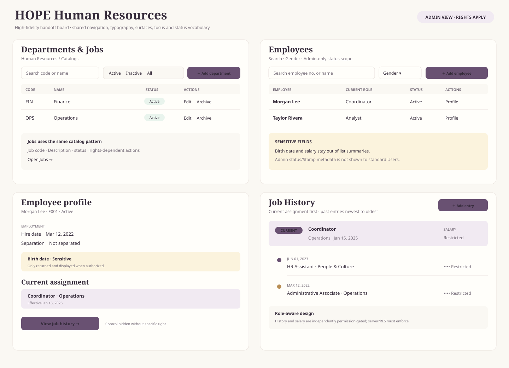

# S3-UIX-04 — HR high-fidelity specification and developer handoff

**Issue:** [#87](https://github.com/jamesseno/Clinic-Squad---HOPE-Inc.-Midterm-Project/issues/87)

**Fidelity:** Proposed static high-fidelity SVG screen board; it is a design artifact, not implemented UI.
**Coverage:** Department, Job, Employee, Employee Profile, Job History.

## Viewable high-fidelity board

[Open the HR high-fidelity SVG board](./s3-issue-87-hr-hifi-board.svg).

## Current UI versus proposed design

**Implemented now:** `/departments`, `/jobs`, and `/employees` exist and implement basic fetch, list, add/edit, soft-delete/restore, and feedback. Employee profile/history is embedded in `/employees`. Current screens use plain tables/forms and inline styles; permissions gate selected controls, while exact server enforcement is outside this visual review.

**Proposed visual direction:** Align with the existing Hope UI tokens documented in [`s1-uix-04-hifi-handoff.md`](./s1-uix-04-hifi-handoff.md): warm off-white page/surface, ink text, purple primary actions/focus, muted dividers, DM Sans body, Cormorant Garamond headings. Use the existing 44px minimum action height, visible 3px focus ring, restrained surface cards, and text status badges. No alternate palette or implementation is being introduced here. The cited Student Guide was not found in this checkout.

## Screen and component contract

| Screen | Proposed hierarchy | Key controls / fields |
|---|---|---|
| Departments | Breadcrumb → title/Add → search/status filter → result count → table/cards | Department Code, Name, Status; Add/Edit/Archive/Restore by right |
| Jobs | Same catalog template | Job Code, Description, Status; same action rules |
| Employees | Breadcrumb → title/Add → search/gender/status filters → list | Employee No., Name, Current Job, Department; Admin status/actions differ from User view |
| Employee profile | Back → identity/status → employment and personal sections → current assignment → history access | Birth date is sensitive; separate View Job History control |
| Job History | Employee context → Current assignment → Past assignments newest-first → Add/Edit affordances | Effective date, job, department, salary gated independently |

**Form treatment:** use a card or modal dialog with a clear title, required markers plus textual “Required” hints, immutable codes/IDs on edit, Cancel and descriptive primary submit. On mobile the form becomes a full-height sheet or page, with persistent actions only if they do not obscure fields. Confirm destructive soft-delete in a named dialog with record identity and reversible-state language.

## Interaction, roles, inactive/error/empty

- Default lists to Active. Admins receive Active / Inactive / All only if allowed; standard Users see active-only data and no lifecycle controls. Hide unauthorized controls and data, but enforce all access in trusted API and RLS.
- Row actions: Profile/View if permitted; Edit and Archive on active rows with matching rights; Restore on inactive rows with restore right. Status and Stamp are administrative metadata.
- Loading: card/table skeleton and live status. Empty dataset: explanatory text and conditionally permitted Add action. No matches: clear search/filter. Fetch error: inline alert and Retry. Save errors remain in the open form; success uses an announced status and refreshed list.
- Invalid values are marked at field level and in a concise form summary. For employees, distinguish optional separation date from archive/deletion; never equate a separated employee with a deleted row.
- History panel: loading, no entries, access denied, salary restricted, and API error states are distinct. Do not show guessed content in a failure state.

## Privacy and accessibility

Employee birth date and job-history salary are sensitive. Keep them out of list summaries, incidental previews, browser titles, URLs, telemetry and printed surfaces unless a specific right permits disclosure. Redaction must happen before data reaches the client; hiding a column is insufficient.

Use landmark/heading hierarchy, real labels and controls, captions/scoped table headers, 4.5:1 text contrast, focus not obscured, keyboard-only operation, non-color status labels, dialog focus management, error associations, polite success announcements, and 44px targets. Respect reduced motion. At 320px, stack filters and profile sections, wrap action groups, and switch dense tables to labeled cards or a contained horizontal-scroll region; never force body-level horizontal scrolling.

## Developer handoff

**Implementing issues:** [#77](https://github.com/jamesseno/Clinic-Squad---HOPE-Inc.-Midterm-Project/issues/77), [#80](https://github.com/jamesseno/Clinic-Squad---HOPE-Inc.-Midterm-Project/issues/80), [#84](https://github.com/jamesseno/Clinic-Squad---HOPE-Inc.-Midterm-Project/issues/84), [#88](https://github.com/jamesseno/Clinic-Squad---HOPE-Inc.-Midterm-Project/issues/88), [#91](https://github.com/jamesseno/Clinic-Squad---HOPE-Inc.-Midterm-Project/issues/91), [#93](https://github.com/jamesseno/Clinic-Squad---HOPE-Inc.-Midterm-Project/issues/93), [#96](https://github.com/jamesseno/Clinic-Squad---HOPE-Inc.-Midterm-Project/issues/96), [#100](https://github.com/jamesseno/Clinic-Squad---HOPE-Inc.-Midterm-Project/issues/100).
This is the consolidated UI contract for those developer tasks, not an implementation or permission grant.
