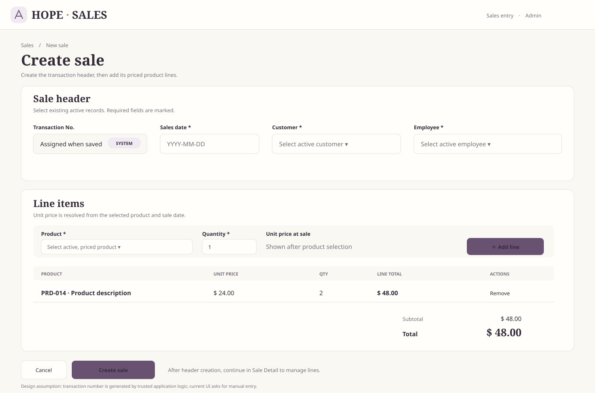

# S4-UIX-01 — Sales list, header, and line-item wireframe handoff

**Issue:** [#46](https://github.com/jamesseno/Clinic-Squad---HOPE-Inc.-Midterm-Project/issues/46)

**Fidelity:** Proposed static SVG screen mockup; existing route behavior is called out separately.

## Viewable mockup

[Open the Sales header and line-item SVG mockup](./s4-issue-46-sales-wireframe-mockup.svg).



## Current UI versus proposed design

**Implemented now:** `/sales` has search, a conditional New Sale action, status, conditional balances, and view/delete/restore actions. `/sales/new` currently asks the user to type a Transaction No. (required, max 8), date, Customer dropdown and Employee dropdown; it creates the header then navigates to detail. `/sales/[transno]` has a line-item form selecting a Product and Quantity, and shows saved unit price and line total.

**Proposed design:** Transaction No. is displayed as system-generated/read-only, as requested by this issue. That differs from current UI, which accepts manual entry; confirm ID-generation behavior with the API owner before treating the field as a generated value. The mockup is descriptive only.

## Wireframes and flow

```text
Sales  [Search transaction/customer…] [Status: Active ▾] [+ New sale]
Transaction | Date | Customer | Employee | Total* | Status | Actions
(*balance fields only with payment-view right)

New sale
Transaction No.  [Generated on save / read-only preview]
Sales date*      [date]
Customer*        [Select existing customer ▾]
Employee*        [Select existing employee ▾]
[Cancel] [Create sale]

Sale detail: [Transaction No.] · [Date] · [Customer] · [Employee] · Status
Line items                         [Product ▾] [Qty*] [Add item]
Product | Unit price at sale | Quantity | Line total | Actions
                                      Subtotal / Total
```

Flow: New Sale → choose date/customer/employee → create header → detail view → add one or more Product/Quantity lines. Product choice resolves the existing product and price; show price as a read-only “Unit price at sale” snapshot and calculate line total. The user reviews the total before leaving. Header and detail are separate persisted steps in current UI; make that boundary explicit (“Sale created; add items next”) so an empty header is not mistaken for a complete transaction.

## Roles, rights, and inactive data

- Sales list/detail and each create/read/edit/delete/restore action requires its own Sale/Sale Detail right. Hide unavailable actions; never rely on visual hiding for access control.
- Admin may see Status/Stamp and Active/Inactive/All filters only with the corresponding rights. Standard User receives active records and no administrative metadata.
- Customer and Employee dropdowns should include only selectable active records in permitted scope. If an existing linked record becomes inactive, retain the readable link on an old sale but prevent selecting it for a new sale; label it “Inactive—existing transaction” where needed.
- Product options require an active, priced product. If no eligible records exist, show a non-selectable explanation and disable submission rather than offering an empty select.
- Inactive sale row: visible “Inactive” badge for authorized Admin only; Restore only with restore right. Do not expose soft-deleted line items without their view-deleted right.
- A user lacking payment rights must not receive total/paid/balance values or related report details.

## States, privacy, responsive/accessibility

Loading options, empty option list, no search matches, empty sale (no line items), stale/inactive linked record, unavailable historical price, form validation, duplicate transaction, permission denial, server/network error and success all need distinct copy/actions. Keep entered data on recoverable errors. Use a field-level quantity error and a visible line total; never silently alter price.

Financial and customer data are business-sensitive. Only request/return fields allowed by server rights; avoid exposing values in hidden controls or client logs. Use semantic forms, explicit labels, required indicators, table caption/headers, keyboard-operable product selection and buttons, visible focus, live status/error announcements, and confirmation before destructive actions. Responsive desktop uses header card plus line table; mobile stacks header fields and converts line rows into labeled cards with quantity/price/total, no body-level horizontal overflow.

## Developer handoff

**Implementing issues:** [#48 — Sales list and New Sale header](https://github.com/jamesseno/Clinic-Squad---HOPE-Inc.-Midterm-Project/issues/48), [#54 — Sale details and price-at-sale](https://github.com/jamesseno/Clinic-Squad---HOPE-Inc.-Midterm-Project/issues/54), [#64 — Sale soft delete/restore/status/stamp](https://github.com/jamesseno/Clinic-Squad---HOPE-Inc.-Midterm-Project/issues/64).
Resolve whether Transaction No. is generated by the database/service or remains user-entered before implementation. This design does not define or grant rights.
