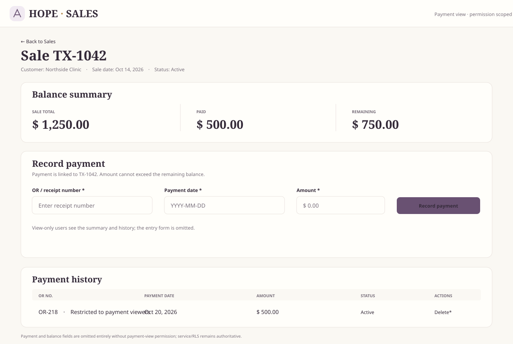

# S4-UIX-02 — Payment and balance wireframe handoff

**Issue:** [#47](https://github.com/jamesseno/Clinic-Squad---HOPE-Inc.-Midterm-Project/issues/47)

**Fidelity:** Proposed static SVG screen mockup; current embedded payment UI is documented below.

## Viewable mockup

[Open the Payment and balance SVG mockup](./s4-issue-47-payment-balance-mockup.svg).



## Current UI versus proposed design

**Implemented now:** Payment entry is embedded on `/sales/[transno]` rather than a separate route. It shows a sale balance, and when permission and positive balance allow, OR/receipt number, payment date and amount fields with Add Payment. Existing payment rows display receipt/date/amount/status and conditional delete/restore actions.

**Proposed design:** Keep payment entry in the sale context to reduce mistaken transaction association. Give it a distinct “Record payment” panel and prominent balance summary; do not imply there is a separate payment screen today. The Student Guide §4.2 is referenced by the issue but was not present in the repository checkout.

## Wireframe and flow

```text
Sale [Transaction No.] · Customer [name/code] · Sale date
┌ Balance summary ──────────────────────────────────┐
│ Sale total [amount]   Paid [amount]   Remaining [amount] │
└───────────────────────────────────────────────────┘
Payments / receipts
OR No.* [________]  Payment date* [date]  Amount* [____]
[Cancel] [Record payment]
Receipt | Date | Amount | Status
```

1. Open a Sale Detail for which the viewer has payment-read permission.
2. Confirm transaction/customer context and remaining balance.
3. Record an OR No., date and positive amount not exceeding remaining balance (subject to confirmed business rules). Save keeps context; success updates paid and remaining totals and appends the payment.
4. If payment access is view-only, show history and balance but no form. If no payment view right, omit the entire section and balance.

## Rights-dependent behavior, inactive/error/empty

- View balance, view payment list, add payment, edit/delete/restore payment are distinct capabilities. The appropriate server-issued right governs each control; the service and RLS must enforce it independently.
- Do not allow posting against an inactive/deleted sale. Show a clear inactive sale label, keep read access only if authorized, and hide Add Payment.
- If remaining balance is zero, show “Paid in full” and omit/disable the form with an explanation. If balance is unavailable, do not default it to zero.
- Empty payments: “No payments recorded.” Empty active sale: keep balance summary and explain no receipts exist.
- Invalid OR number/date/amount, duplicate receipt, amount-over-balance conflict, stale balance, permission denied and network failure each get inline feedback; preserve user-entered values when safe to retry.
- Loading balance and payment list are separate announced states; retry only failed portions. Successful entry uses a polite status and refreshes the balance.

## Privacy, responsive and accessibility notes

Amounts, customer identity and OR numbers are sensitive financial/business records; show only to payment-view-authorized users and avoid browser history/query strings, client logs, or unauthorized printed reports. Masking must occur server-side as well as in presentation.

Use a labeled balance definition list with currency/precision from the application’s existing convention; label “Remaining” in text, not just color. Labels, required state, helper text, field-specific errors, keyboard order, 44px touch targets, visible focus and `role=status`/`role=alert` feedback are required. On mobile stack the balance summary and form fields; keep Save/Cancel reachable without horizontal scrolling. For assistive technology, announce updated balance after a successful payment without repeatedly announcing the entire page.

## Developer handoff

**Implementing issues:** [#57 — Record payment against a transaction](https://github.com/jamesseno/Clinic-Squad---HOPE-Inc.-Midterm-Project/issues/57), [#61 — Balance view per transaction and customer](https://github.com/jamesseno/Clinic-Squad---HOPE-Inc.-Midterm-Project/issues/61). Related sale lifecycle behavior: [#64](https://github.com/jamesseno/Clinic-Squad---HOPE-Inc.-Midterm-Project/issues/64).
Confirm amount/date/receipt business rules with the API/data owner; this document specifies the presentation contract only.
