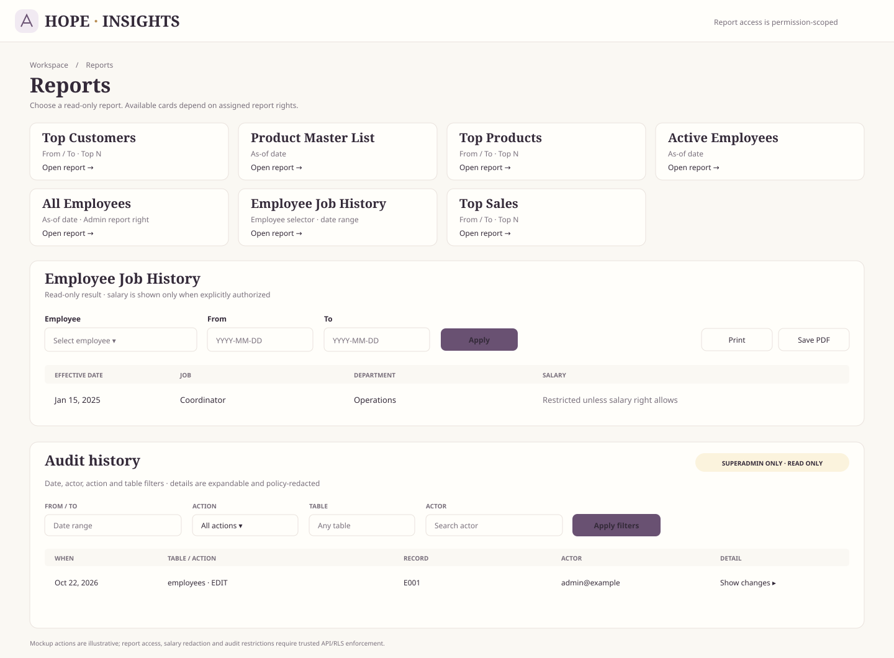

# S4-UIX-03 — Reports and audit viewer wireframe handoff

**Issue:** [#50](https://github.com/jamesseno/Clinic-Squad---HOPE-Inc.-Midterm-Project/issues/50)
**Fidelity:** Proposed static SVG screen mockup with report and audit states.

## Viewable mockup

[Open the Reports and Audit SVG mockup](./s4-issue-50-reports-audit-mockup.svg).



## Current UI versus proposed design

**Implemented now:** `/reports` fetches the user’s available report links and displays loading/error/no-access states. A report route provides some filters, result tables and Print / Save PDF. The current Employee Job History selector is a free-text employee code field, not a selector; the report table is generic. `/audit` presents date/action/table/actor filters and read-only old/new values with paging, and notes that it is Superadmin-only.

**Proposed design:** Provide titled report cards, each with a documented filter set and named result columns; Employee Job History uses an employee selector. The audit viewer gets a consistent filter bar, audit-data privacy treatment and explicit authorized-only entry. Do not claim PDF download or report rights beyond the current print action without implementation.

## Report catalog and filter wireframe

```text
Reports
┌ Top Customers ────────────────┐  ┌ Product Master List ─────┐
│ Date range · Top N · [Open]   │  │ As-of date · [Open]      │
└───────────────────────────────┘  └───────────────────────────┘
Top Products | Active Employees | All Employees |
Employee Job History | Top Sales

Report: [Title]   Filters [from] [to] [Top N / As-of / Employee ▾]
[Apply] [Reset]                   [Print] [Save as PDF]*
Read-only results table with applied-filter summary
*Enable only for successful, non-empty results and authorized role.
```

| Report | Filters proposed |
|---|---|
| Top Customers | From, To, Top N |
| Top Products | From, To, Top N |
| Top Sales | From, To, Top N; Employee if supported by report/API |
| Product Master | As-of date |
| Active Employees | As-of date |
| All Employees | As-of date; administrative right |
| Employee Job History | Employee selector; From/To if supported; salary only with salary/report right |

Use the exact report-title and filter naming agreed with the report API. Date ranges should be validated (`From` ≤ `To`); Top N should have an allowed range/step confirmed by API constraints.

## Audit viewer wireframe and rights behavior

```text
Superadmin / Audit history — read only
Date [from]–[to]  Action [All ▾]  Table [____]  Actor [____]
[Apply filters] [Reset]
When | Table | Action | Record | Actor | Changed fields (expand)
               [Previous] Page N [Next]
```

Reports are read-only; no row CRUD actions. Render a report only if its specific report right is assigned; no-right state says “No report access has been assigned.” Audit navigation and API are Superadmin-restricted; non-authorized users should receive no audit entries, not a disabled table. Show “Print” and “Save as PDF” only to authorized users; print layout omits navigation and unnecessary personal data. Old/new audit values may contain sensitive fields: collapse details by default, redact according to policy, and restrict access at API/RLS. Do not render raw JSON as the primary user experience.

## States, privacy, accessibility and responsive

Loading report/list; empty results; no report rights; no employee options; invalid filters; request/access error; stale/restricted data; print/PDF unavailable are distinct states. Keep filter values on fetch errors; show active filter summary and a Reset action. Empty result is not an error. For audit, distinguish no matching entries from access denied.

Employee Job History and All Employees may disclose personal/salary details. Salary is hidden unless the explicit salary/report right allows it, including in generated print/PDF. Do not use client-only masking. Apply least-privilege rights at report API and database layer.

Use a labeled filter form, semantic report headings, caption and headers for results, sortable headers only if genuinely supported, live loading/error feedback, visible focus and full keyboard operation. Audit old/new values are expandable buttons with `aria-expanded` and descriptive names. At narrow widths filters stack, results become labeled cards or a contained scroll area, and audit diffs wrap safely; print stylesheet uses legible black-on-white and repeats table headers where possible.

## Developer handoff

**Implementing issues:** [#58 — Reports module part 1](https://github.com/jamesseno/Clinic-Squad---HOPE-Inc.-Midterm-Project/issues/58), [#60 — Reports module part 2](https://github.com/jamesseno/Clinic-Squad---HOPE-Inc.-Midterm-Project/issues/60), [#70 — Superadmin audit log viewer](https://github.com/jamesseno/Clinic-Squad---HOPE-Inc.-Midterm-Project/issues/70).
Confirm report rights, employee selector options, printable fields and salary visibility against API/RLS and the data owner’s report contract.
