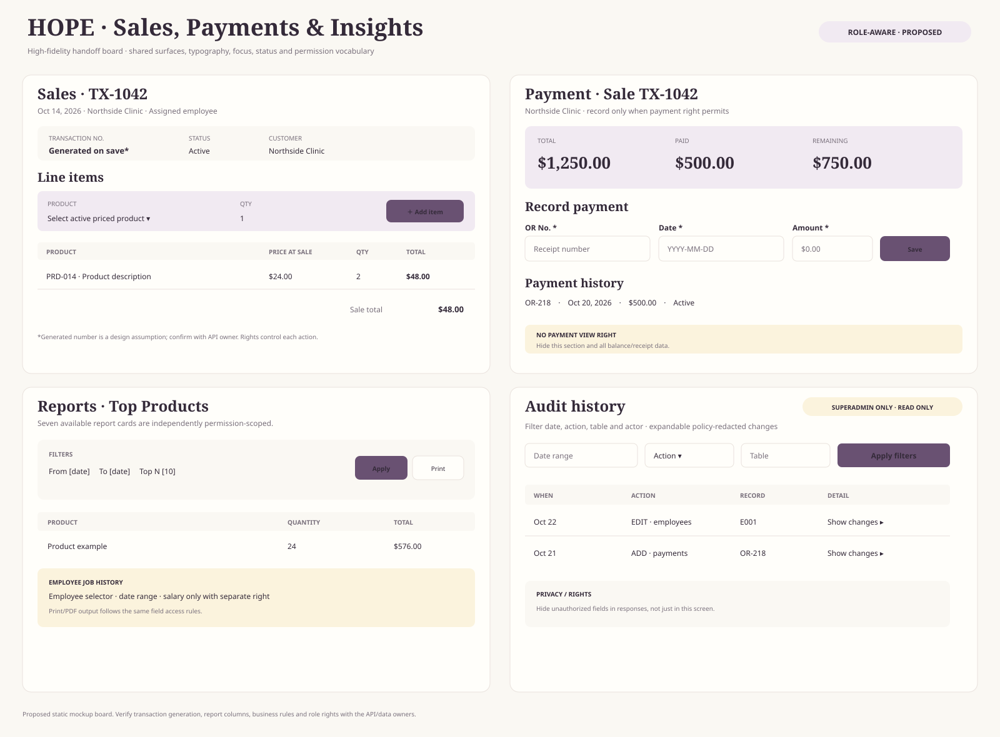

# S4-UIX-04 — Sales, Payment, Reports and Audit high-fidelity handoff

**Issue:** [#53](https://github.com/jamesseno/Clinic-Squad---HOPE-Inc.-Midterm-Project/issues/53)
**Fidelity:** Proposed static high-fidelity SVG board; design artifact only, not implemented UI.

## Viewable high-fidelity board

[Open the Sales, Payment, Reports and Audit SVG board](./s4-issue-53-sales-hifi-board.svg).

## Current UI versus proposed design

**Implemented now:** Sales list, new-sale header, sale detail with line items and embedded payments, seven report routes/catalog and a read-only audit viewer are present in the checked-in app. Current pages are mostly native controls/tables and inline styles. New sale asks for a transaction number rather than displaying a generated one. Report output is generic; report employee filtering is free text. Audit old/new values display raw JSON.

**Proposed visual direction:** Follow the current Hope UI visual system in [`s1-uix-04-hifi-handoff.md`](./s1-uix-04-hifi-handoff.md): `#faf8f3` page, `#fffefa` surface, `#342a39` ink, `#695172` primary/focus, `#e9e2dd` rules, DM Sans body and Cormorant headings. Use restrained cards, consistent 44px controls, visible keyboard focus and status badges with text. This document does not say the existing app already uses these polished components.

## Screen/component specifications

| Area | Proposed hierarchy/components |
|---|---|
| Sales list | Title/New Sale → search and authorized status filter → responsive transaction table/cards → row view/lifecycle actions; balances only for payment readers |
| Sale header | Transaction No. (generated/read-only if backend supports), date, existing Customer/Employee selections, save/cancel |
| Sale detail | Context/status header → total/paid/remaining if permitted → line-item editor and list → payment section if permitted |
| Payment | Contextual balance summary → OR No./date/amount form → payment history, each mutation right-scoped |
| Report catalog | Report cards with purpose/filter summary and only authorized links |
| Report result | Named title/filter form → active-filter summary → read-only results → Print/Save PDF action, print-optimized |
| Audit | Superadmin-only title/notice → date/action/table/actor filters → paged read-only entries → expandable/redacted diff details |

## Interaction and validation contract

- Preserve context across New Sale → details. Where creation is split into header and lines, explicitly tell the user what remains to finish.
- Validate date range, required relations, quantity > 0, amount > 0 and not above remaining balance if that is the confirmed business rule. Server errors stay associated with fields and preserve safe drafts.
- Calculate line total from authoritative historical unit price; show the unit-price basis. Do not let a display value imply the client is authoritative for price or total.
- Distinguish inactive sale, inactive linked customer/employee/product, zero balance, no line items, no payment records, no report matches, no report rights, and load/network error.
- Search/filter changes and actions provide clear feedback and retain the current record context. Destructive lifecycle actions use a confirmation dialog naming the record and “archive/deactivate” language when soft-delete applies.
- Print and Save as PDF are explicit actions. The current implementation’s “Print / Save PDF” invokes browser print; a separate PDF-generation feature is proposed only if the product supports it.

## Role, rights and privacy contract

Separate view/add/edit/delete/restore rights for Sale, Sale Detail, Payment, each report and Audit. Use received permission state only to decide what to present. Route/API queries and Supabase RLS must enforce the same access; deny direct requests. Admin-only Status/Stamp and inactive records are absent for standard Users.

Financial amounts, customer details, employee identifiers, OR numbers, salary and audit old/new values are sensitive. Only request/return authorized fields; do not rely on hidden columns. Salary in Employee Job History report requires both the applicable report right and salary disclosure right. Print output must honor the same scope; audit diffs should redact restricted fields and expand on explicit request.

## Responsive and accessibility contract

Use landmarks, one h1 per screen, explicit labels, required indicators, helper/error associations, table captions/headers, keyboard-operable dialogs/expanders, visible focus, 4.5:1 text contrast, 44px targets, polite loading/success updates and assertive actionable errors. Status is always text + color/icon; never color alone.

Desktop: page title and primary action in one row, filter toolbar wraps, data tables within cards. Tablet/mobile: stack filters and header fields, switch transaction/payment rows to labeled cards or bounded horizontal scrolling, keep balance values in a readable definition list, and place form actions after fields. Audit diff content wraps and does not create body overflow. Respect zoom and reduced-motion preferences.

## Developer handoff

**Implementing issues:** [#48](https://github.com/jamesseno/Clinic-Squad---HOPE-Inc.-Midterm-Project/issues/48), [#54](https://github.com/jamesseno/Clinic-Squad---HOPE-Inc.-Midterm-Project/issues/54), [#57](https://github.com/jamesseno/Clinic-Squad---HOPE-Inc.-Midterm-Project/issues/57), [#58](https://github.com/jamesseno/Clinic-Squad---HOPE-Inc.-Midterm-Project/issues/58), [#60](https://github.com/jamesseno/Clinic-Squad---HOPE-Inc.-Midterm-Project/issues/60), [#61](https://github.com/jamesseno/Clinic-Squad---HOPE-Inc.-Midterm-Project/issues/61), [#64](https://github.com/jamesseno/Clinic-Squad---HOPE-Inc.-Midterm-Project/issues/64), [#70](https://github.com/jamesseno/Clinic-Squad---HOPE-Inc.-Midterm-Project/issues/70).
Use API/data-owner confirmation for pricing, transaction-number generation, rights, report columns, and payment constraints. This is not a security review or an authorization grant.
